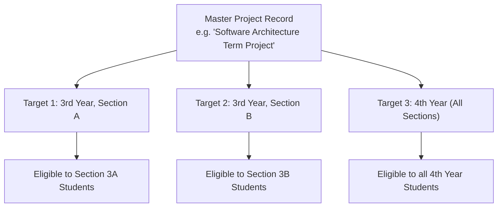

# HU-ASMS: Academic Management Architecture & Multi-Scope Targeting

## 1. Overview

In HU-ASMS, courses, teachers, and academic projects are dynamic entities stored relationally. Nothing is hardcoded to a specific class, academic year, course, or teacher.

```
Department (e.g. Software Engineering)
  ├── Courses (e.g. SEng3112 Database Management)
  └── Teachers (e.g. Dr. Abebe Kebede - Delivery Recipient)
       └── Projects (e.g. Hospital Database Normalization Assignment)
            ├── project_targets (Links to 3rd Year Section A & Section B)
            └── project_file_rules (PDF only, 20MB max, group 1-1)
```

---

## 2. Course & Teacher Management

- **Courses**:
  - Identified by unique course code (e.g. `SENG3112`).
  - Associated with academic departments via foreign key.
  - Can be activated or deactivated without losing historical project associations.
- **Teachers**:
  - Act as academic delivery recipients for submissions.
  - No initial login required in v1; recorded dynamically with email, phone, and optional Telegram ID.
  - Projects link directly to teachers for representative manual delivery workflows.

---

## 3. Dynamic Projects & Multi-Scope Targeting

A single academic project can be targeted across multiple academic years or sections simultaneously without duplicating the project definition:



### Targeting Rules:
- If `section_id` is specified, only students in that specific section can view and submit to the project.
- If `section_id` is `NULL`, all sections belonging to that `academic_year_id` inherit eligibility.
- Students in non-targeted years or sections cannot see or submit to the project.

---

## 4. Configurable Project File Rules

Every project specifies granular submission constraints:
- `allowed_extensions`: Array of allowed extensions (e.g. `['pdf']` or `['pdf', 'zip']`).
- `allowed_mime_types`: Explicit MIME checking (e.g. `application/pdf`).
- `max_file_size_bytes`: Byte limit (default 20MB, up to 50MB for zip files).
- `min_group_size` and `max_group_size`: For group projects, bounds team capacity (e.g. 2 to 5 members).
- `chk_deadline_after_opening`: Database-level check constraint guaranteeing deadline is set after opening date.
