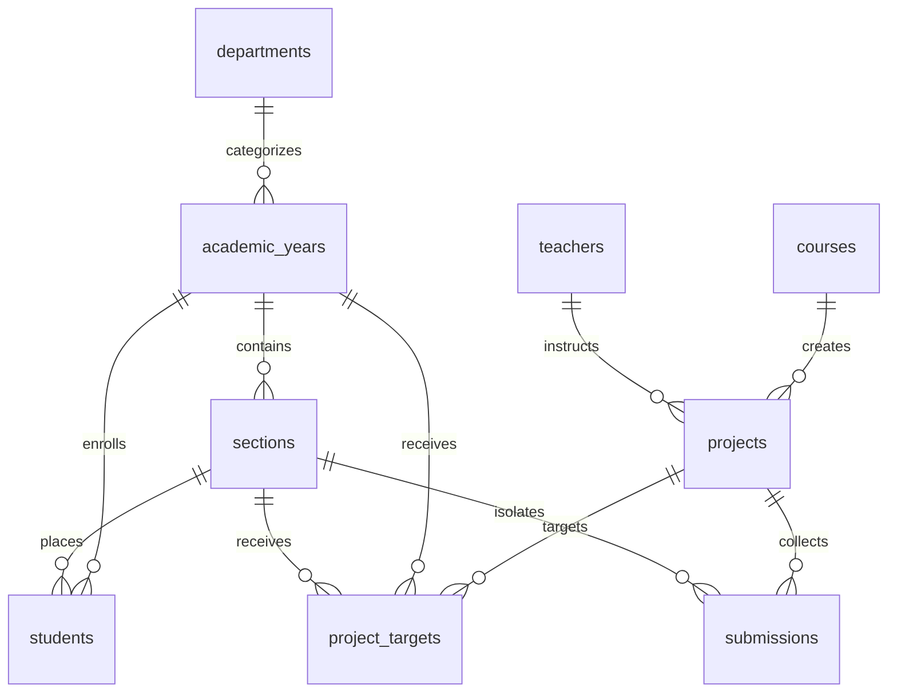
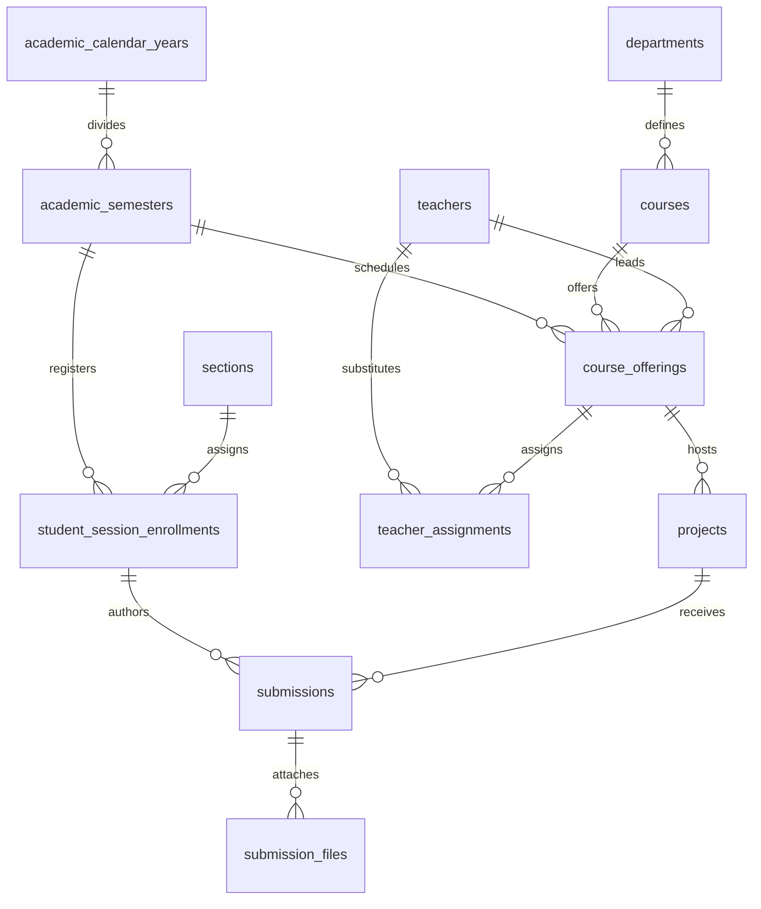
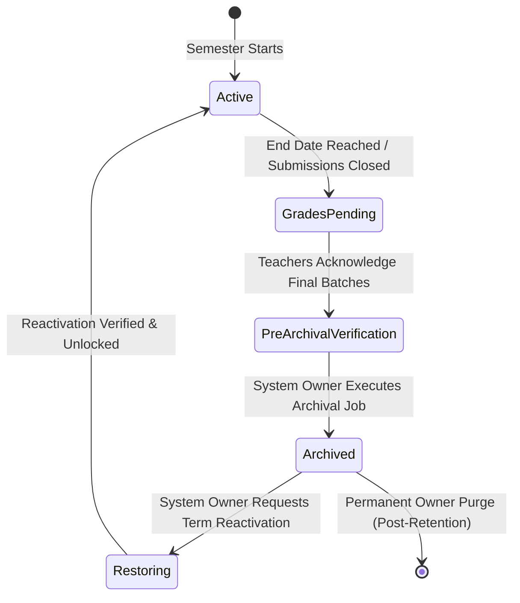
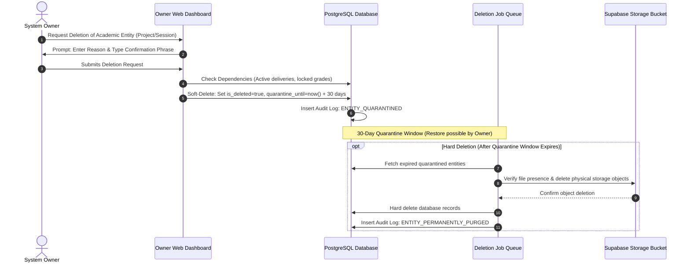
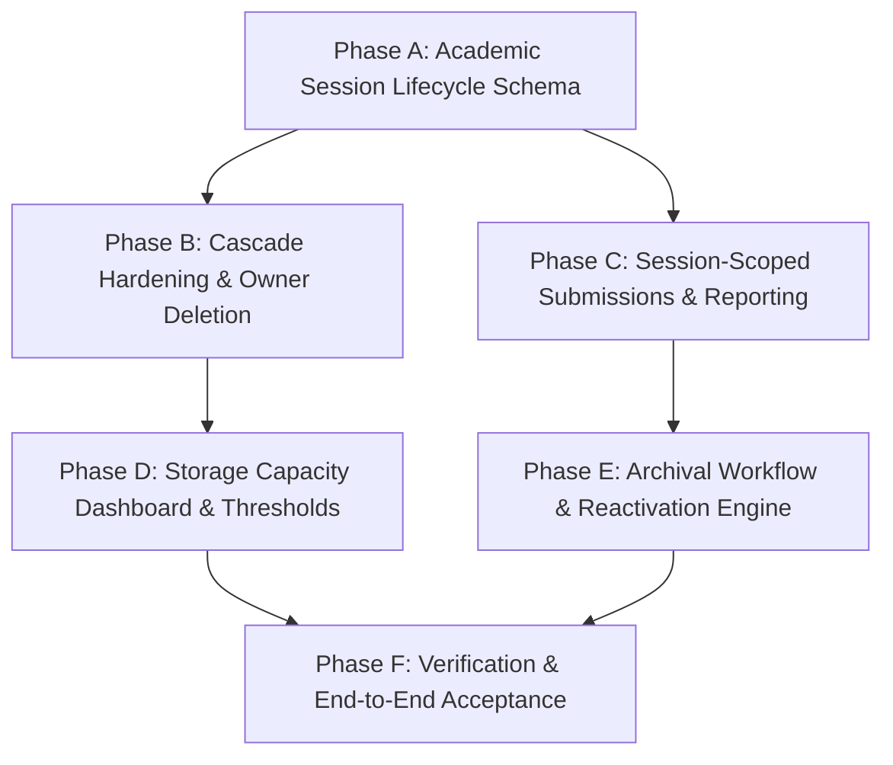

# HU-ASMS — Academic Session Lifecycle, Storage Capacity, Archival and System Owner-Only Deletion
## Comprehensive Architecture Audit & Engineering Specification

**Document Status**: `READY FOR IMPLEMENTATION APPROVAL`  
**Execution Mode**: STRICT READ-ONLY AUDIT & ARCHITECTURAL PROPOSAL ONLY  
**Target Project**: `tkdrxfvxryemfdrwcmay`  
**Date**: November 13, 2026  
**Auditor**: Antigravity DeepMind Agent  

---

## 1. Verified Current Storage Configuration and Usage

### A. Verified Bucket Inventory & Configuration
Inspection of `supabase/migrations/20261110000003_storage_setup.sql` confirms the active Supabase Storage infrastructure:

| Property | Value | Evidence / Source |
|---|---|---|
| **Active Storage Buckets** | Exactly **1** bucket: `submission-files-vault` | `20261110000003_storage_setup.sql:5-18` |
| **Public Status** | `public = false` (Strictly Private) | `20261110000003_storage_setup.sql:9` |
| **Per-File Size Limit** | `52,428,800` bytes (**50 MB**) | `20261110000003_storage_setup.sql:10` |
| **Effective Bot API Limit** | `20,971,520` bytes (**20 MB**) | `packages/shared/src/constants.ts` & Telegram Cloud Bot API limits |
| **Allowed MIME Types** | `application/pdf`, `application/zip`, `application/x-zip-compressed`, `application/vnd.openxmlformats-officedocument.wordprocessingml.document`, `application/msword` | `20261110000003_storage_setup.sql:11-17` |
| **Physical Storage Paths** | Individual: `projects/${projectId}/individual/${studentId}/v${version}_${safeFilename}`<br>Group: `projects/${projectId}/groups/${groupId}/v${version}_${safeFilename}` | `apps/bot/src/services/submission.service.ts:199`<br>`apps/bot/src/services/group-submission.service.ts:244` |
| **Storage Upload Guard** | `upsert: false` (Prevents silent object overwriting) | `apps/bot/src/utils/submission-storage.ts:134` |
| **Storage Object Access** | System Owner: FULL access.<br>Representatives: SELECT access strictly scoped via `auth_is_rep_for_section(s.section_id)`.<br>Students: **ZERO web storage download policy exists** (Web gap). | `20261110000003_storage_setup.sql:33-60` |

### B. Capacity & Current Usage Assessment
- **Reliably Verified via Schema**: File size limit is 50 MB; upload restricts to OOXML, PDF, and ZIP.
- **Current Usage Metric**:
  - Live API connection to `https://tkdrxfvxryemfdrwcmay.supabase.co/storage/v1` times out from this local environment (`ConnectTimeoutError`).
  - Total storage usage in Supabase is not exposed via standard PostgREST tables. It must be computed either from `SELECT SUM(file_size_bytes) FROM submission_files` or fetched via the Supabase Management API (`https://api.supabase.com/v1/projects/{ref}/usage`).
- **Quota & Billing Boundary (Supabase Tier)**:
  - *Free Tier*: **1 GB total storage** included across all buckets.
  - *Pro Tier*: **100 GB total storage** included ($0.021 per additional GB).
  - *Capacity Risk*: A single university section of 25 students submitting six 10 MB assignments across a semester consumes:
    $$25 \times 6 \times 10\text{ MB} = 1.5\text{ GB}$$
    This **exceeds the 1 GB Supabase free tier limit** in a single semester.

---

## 2. Current Academic Session Architecture & Flaws

### A. Existing Relational Model
The current database schema (`supabase/migrations/20261110000001_initial_schema.sql`) implements the following hierarchy:



### B. Severe Architectural Deficiencies Identified

1. **`academic_years` Represents Year-Level, Not Calendar Sessions**:
   - `academic_years` has columns `(id, name, year_level, is_active)`. In seed data and code, this stores *2nd Year*, *3rd Year*, *4th Year*, *5th Year*.
   - There is **no entity** for the calendar session (e.g., `2025/2026`, `2026/2027`) or the academic semester (e.g., `Semester I`, `Semester II`).
2. **Destructive Student Advancement**:
   - `students.academic_year_id` and `students.section_id` are stored directly on the `students` master row.
   - When a student completes Year 2 Section A and advances to Year 3 Section B, updating these columns **destroys their historical enrollment in Year 2 Section A**.
   - Historical submissions, group memberships, and representative scopes become corrupted or fail section-matching integrity checks.
3. **No Course Offering Layer & Historical Teacher Overwrites**:
   - A `project` references a `course_id` and a `teacher_id` directly.
   - If Teacher A teaches `Compiler Construction` in Fall 2025 and Teacher B teaches it in Fall 2026, or if a teacher is substituted mid-session, editing `projects.teacher_id` mutates the historical record for already-delivered batches and submitted assignments.
4. **Catastrophic Cascade Deletion Red Flag**:
   - In `20261110000001_initial_schema.sql`:
     ```sql
     courses (id) ON DELETE CASCADE -> projects (course_id)
     projects (id) ON DELETE CASCADE -> submissions (project_id)
     submissions (id) ON DELETE CASCADE -> submission_files (submission_id)
     submissions (id) ON DELETE CASCADE -> submission_members (submission_id)
     projects (id) ON DELETE CASCADE -> deliveries (project_id)
     ```
   - **Critical Vulnerability**: Deleting a single course cascades down and silently purges all projects, all submissions, all group member snapshots, and all delivery records across university history!

---

## 3. Proposed Academic Session Data Model

To preserve historical accuracy, support multiple semesters, handle mid-semester teacher changes, and prevent accidental cascade deletions, we propose an authoritative, non-destructive **Academic Session Architecture**.

### A. Entity-Relationship Diagram



### B. Proposed New Entities & Specifications

#### 1. `academic_calendar_years` (Calendar Period)
Represents the university academic year (e.g. `2025/2026`, `2026/2027`).
- `id` UUID PRIMARY KEY DEFAULT gen_random_uuid()
- `code` VARCHAR(20) UNIQUE NOT NULL (e.g. `'2025-2026'`)
- `name` VARCHAR(100) NOT NULL (e.g. `'2025/2026 Academic Year'`)
- `start_date` DATE NOT NULL
- `end_date` DATE NOT NULL
- `status` VARCHAR(20) NOT NULL DEFAULT 'active' (`'upcoming'`, `'active'`, `'archived'`, `'closed'`)
- `created_at`, `updated_at` TIMESTAMPTZ

#### 2. `academic_semesters` (Term Lifecycle)
Represents the specific academic term.
- `id` UUID PRIMARY KEY DEFAULT gen_random_uuid()
- `calendar_year_id` UUID NOT NULL REFERENCES academic_calendar_years(id) ON DELETE RESTRICT
- `term` VARCHAR(20) NOT NULL (`'semester_1'`, `'semester_2'`, `'kiremt'`)
- `name` VARCHAR(100) NOT NULL (e.g. `'2026/2027 — Semester I'`)
- `start_date` DATE NOT NULL
- `end_date` DATE NOT NULL
- `is_current` BOOLEAN NOT NULL DEFAULT false
- `status` VARCHAR(20) NOT NULL DEFAULT 'active' (`'planning'`, `'active'`, `'grades_pending'`, `'archived'`)
- `CONSTRAINT uq_year_term UNIQUE (calendar_year_id, term)`

#### 3. `student_session_enrollments` (Historical Enrollment Preservation)
Decouples student enrollment from the static `students` row. When a student advances to a new year, a new enrollment row is created, preserving past terms.
- `id` UUID PRIMARY KEY DEFAULT gen_random_uuid()
- `student_id` UUID NOT NULL REFERENCES students(id) ON DELETE RESTRICT
- `semester_id` UUID NOT NULL REFERENCES academic_semesters(id) ON DELETE RESTRICT
- `academic_year_level_id` UUID NOT NULL REFERENCES academic_years(id) ON DELETE RESTRICT (Year 2, Year 3, etc.)
- `section_id` UUID NOT NULL REFERENCES sections(id) ON DELETE RESTRICT
- `enrollment_status` VARCHAR(30) NOT NULL DEFAULT 'enrolled' (`'enrolled'`, `'withdrawn'`, `'suspended'`, `'completed'`)
- `enrolled_at` TIMESTAMPTZ NOT NULL DEFAULT clock_timestamp()
- `CONSTRAINT uq_student_semester UNIQUE (student_id, semester_id)`

#### 4. `course_offerings` (Term Course Delivery & Primary Instructor)
Binds a course to an academic semester and section, assigning the authoritative teacher.
- `id` UUID PRIMARY KEY DEFAULT gen_random_uuid()
- `semester_id` UUID NOT NULL REFERENCES academic_semesters(id) ON DELETE RESTRICT
- `course_id` UUID NOT NULL REFERENCES courses(id) ON DELETE RESTRICT
- `section_id` UUID NOT NULL REFERENCES sections(id) ON DELETE RESTRICT
- `primary_teacher_id` UUID NOT NULL REFERENCES teachers(id) ON DELETE RESTRICT
- `syllabus_url` TEXT
- `status` VARCHAR(20) NOT NULL DEFAULT 'active' (`'active'`, `'completed'`, `'archived'`)
- `CONSTRAINT uq_course_semester_section UNIQUE (semester_id, course_id, section_id)`

#### 5. `teacher_assignments` (Teacher Substitution with Effective Dates)
Tracks mid-semester instructor handovers without altering past delivery history.
- `id` UUID PRIMARY KEY DEFAULT gen_random_uuid()
- `course_offering_id` UUID NOT NULL REFERENCES course_offerings(id) ON DELETE RESTRICT
- `teacher_id` UUID NOT NULL REFERENCES teachers(id) ON DELETE RESTRICT
- `role` VARCHAR(30) NOT NULL DEFAULT 'lead' (`'lead'`, `'co_instructor'`, `'substitute'`, `'teaching_assistant'`)
- `effective_from` DATE NOT NULL
- `effective_to` DATE (NULL = currently active)
- `reason` TEXT
- `assigned_by` UUID REFERENCES profiles(id) ON DELETE SET NULL

---

## 4. Proposed Archival Lifecycle

### A. Archival State Machine



### B. Archival Rules & Preservation Guarantees
1. **Read-Only Lock**:
   When an academic semester transitions to `status = 'archived'`:
   - All `projects`, `course_offerings`, `submissions`, and `groups` within that semester become immutable.
   - Database triggers reject any `INSERT`, `UPDATE`, or `DELETE` on submissions or groups for archived semesters.
   - Ordinary students and representatives can view archived work in read-only mode; they **cannot submit, resubmit, or alter members**.
2. **Representative Scope Sunset**:
   - `representative_assignments.is_active` for that semester's sections is set to `false`, revoking active administrative powers while preserving the historical assignment row and audit logs.
3. **Storage Tier Evaluation: Hot vs. Cold Storage**:
   - *Cold Storage Analysis (e.g. AWS S3 Glacier / GCP Coldline)*:
     - **Cost Myth**: Moving files from `submission-files-vault` to another Supabase bucket does **not** reduce costs (Supabase charges for total aggregate storage across all project buckets).
     - **External Cold Storage Trade-offs**:
       - *Storage Savings*: S3 Glacier Deep Archive costs ~$0.00099/GB/mo vs Supabase ~$0.021/GB/mo (a ~95% saving on raw storage).
       - *Retrieval Latency*: Glacier retrieval requires 3–5 hours (or expensive Expedited Retrieval). If an academic committee or grade appeal requires reviewing a past assignment, a 5-hour retrieval delay impairs university operations.
       - *Egress Penalty*: Supabase egress fees apply when transferring files out to external clouds.
     - **Recommendation**: Retain current and prior year (last 3 semesters) in Supabase Storage **Hot Tier** for instant bot/web access. Archive sessions older than 2 years to an external S3-compatible cold vault with cryptographic SHA-256 manifests.

---

## 5. System Owner-Only Deletion Design

### A. Authorization Matrix: Strict Owner Exclusivity

| Action | Student | Representative | Course Teacher | Dept Head | System Owner |
|---|---|---|---|---|---|
| **Delete Individual Submission** | ❌ DENIED | ❌ DENIED | ❌ DENIED | ❌ DENIED | **ALLOWED (With Reason)** |
| **Delete Submission File Binary** | ❌ DENIED | ❌ DENIED | ❌ DENIED | ❌ DENIED | **ALLOWED (Via Job)** |
| **Delete Project** | ❌ DENIED | ❌ DENIED | ❌ DENIED | ❌ DENIED | **ALLOWED (Empty only)** |
| **Delete Academic Semester** | ❌ DENIED | ❌ DENIED | ❌ DENIED | ❌ DENIED | **ALLOWED (Post-Retention)** |
| **Delete Audit Logs** | ❌ DENIED | ❌ DENIED | ❌ DENIED | ❌ DENIED | ❌ **FORBIDDEN (IMMUTABLE)** |

### B. Two-Phase Deletion & Quarantine Architecture



### C. Technical Safety Safeguards
1. **Database Constraint & Trigger Protections**:
   - Replace all dangerous `ON DELETE CASCADE` rules on core academic entities with `ON DELETE RESTRICT`.
   - Add trigger `trg_prevent_non_owner_delete` on `submissions`, `submission_files`, `projects`, and `announcements`. Rejects any `DELETE` statement if `auth_is_system_owner()` is false.
2. **Audit Log Immutability**:
   - `audit_logs` table has `REVOKE DELETE, UPDATE ON public.audit_logs FROM PUBLIC, anon, authenticated, service_role`.
   - When records are purged, the audit log entries documenting the deletion are preserved forever.
3. **Physical Object Deletion Verification**:
   - The deletion background worker deletes the database record only **after** the storage API confirms HTTP 200/204 removal of the physical object. If storage fails, the job retries with exponential backoff.

---

## 6. Storage Capacity Monitoring Design

### A. System Owner Storage Dashboard Metrics

The proposed dashboard at `/admin/system/storage` provides real-time visibility:

1. **Overall Capacity Gauge**:
   - Total Available Quota (e.g. 1 GB Free Tier / 100 GB Pro Tier).
   - Used Storage in Bytes and Percentage.
   - Available Remaining Headroom.
2. **Usage by Academic Session**:
   - Stacked breakdown showing storage consumed by `2025/2026 Semester I`, `2025/2026 Semester II`, `2026/2027 Semester I`.
3. **Usage by Category**:
   - Student Submissions (`submission-files-vault`).
   - Official Project Instructions (`project-instruction-vault`).
   - Representative Announcements (`announcement-materials-vault`).
4. **Health & Orphan Tracking**:
   - Orphaned Storage Objects (Files in bucket with no corresponding database record).
   - Missing Storage Objects (Database records whose storage path returns 404).
   - Failed Upload Count (Incomplete transmissions).

### B. Configurable Warning Thresholds
- **Threshold 1 (70% — Notice)**: Amber indicator in System Owner dashboard. Weekly summary report.
- **Threshold 2 (85% — Warning)**: Orange banner across all administrative pages. Telegram alert dispatched to System Owner.
- **Threshold 3 (95% — Critical Emergency)**: Red alert banner. Automated notification to System Owner advising quota upgrade or archival of historical sessions.
- **Strict Non-Destructive Invariant**: Reaching thresholds **never triggers automatic file deletion**. Uploads gracefully reject with user-friendly error messages (`"University storage capacity reached. Contact administrator."`) rather than corrupting files or purging past records.

---

## 7. Performance & Scaling Plan

1. **Mandatory Pagination Across Bot & Web**:
   - Web tables: 25 items per page with server-side `limit`/`offset` and range headers.
   - Telegram bot: 10 items per page with inline navigation (`[◀️ Prev] [Page X/Y] [Next ▶️]`).
2. **Indexed Metadata Queries**:
   - Composite indexes on high-traffic paths:
     ```sql
     CREATE INDEX idx_submissions_scope ON submissions(project_id, section_id, status);
     CREATE INDEX idx_student_enrollments_scope ON student_session_enrollments(semester_id, section_id, enrollment_status);
     ```
3. **Zero-Binary Report Principle**:
   - Generating submission reports or viewing missing lists **never reads file binaries**. Queries fetch strictly metadata (`original_filename`, `file_size_bytes`, `checksum_sha256`, `created_at`).
4. **Streaming & Telegram Document Caching**:
   - When a representative requests a file, the bot first attempts delivery via cached `telegram_file_id` (sub-second, 0 storage bandwidth).
   - If fallback is needed, the file streams directly from Supabase Storage without buffering entire multi-file batches into server memory.

---

## 8. Backup and Restoration Plan

### A. Backup Strategy
1. **Database Backups**:
   - Daily automated PostgreSQL `pg_dump` snapshot stored in an isolated, encrypted secondary storage region.
   - Point-in-Time Recovery (PITR) enabled on Supabase Pro tier (allowing restoration to any second within 7 days).
2. **Storage Bucket Backups**:
   - Nightly rsync / bucket replication job synchronizing `submission-files-vault` to an encrypted secondary bucket or external object store.
   - SHA-256 integrity verification: Manifest validates that stored checksums match replicated binaries.

### B. Restoration Procedure
1. **Term Reactivation Workflow**:
   - If an archived semester needs correction (e.g. grade appeal), System Owner executes `/admin/academics/sessions/[id]/restore`.
   - Changes `academic_semesters.status = 'active'`, logging `SEMESTER_REACTIVATED` with mandatory reason.
2. **Disaster Recovery RTO & RPO**:
   - Recovery Time Objective (RTO): $\le 2$ hours to restore full operational state.
   - Recovery Point Objective (RPO): $\le 1$ hour of submission data loss in a catastrophic datacenter failure.

---

## 9. Required Migrations and Files (Listed, Not Created)

*(No files or migrations have been created. These represent the engineering blueprint).*

### Proposed SQL Migrations
1. `supabase/migrations/20261114000001_academic_session_lifecycle.sql`:
   - Creates `academic_calendar_years`, `academic_semesters`, `student_session_enrollments`, `course_offerings`, `teacher_assignments`.
   - Modifies `projects` to reference `course_offerings(id)` on delete restrict.
2. `supabase/migrations/20261114000002_safe_deletion_and_cascade_hardening.sql`:
   - Drops dangerous `ON DELETE CASCADE` rules on `courses`, `projects`, and `submissions`.
   - Implements `trg_prevent_non_owner_delete` trigger.
3. `supabase/migrations/20261114000003_storage_monitoring_and_quarantine.sql`:
   - Creates `quarantined_entities`, `storage_capacity_settings`, and `storage_audit_ledger` tables.

### Proposed Code Files
1. `packages/database/src/academic-session-service.ts`: Session lifecycle management.
2. `apps/web/src/lib/admin/storage-management-service.ts`: Storage metrics calculation and threshold alerting.
3. `apps/web/src/app/admin/system/storage/page.tsx`: System Owner storage monitoring dashboard.
4. `apps/web/src/app/admin/academics/sessions/page.tsx`: Academic session and semester manager.
5. `apps/bot/src/handlers/storage-retrieval.handler.ts`: Secure on-demand PDF streaming for bot.

---

## 10. Critical Red Flags & Unresolved Questions

1. **[CRITICAL] Free Tier 1 GB Limit vs. Academic Reality**:
   - *Finding*: If the live Supabase project is on the Free Tier, a single section will exhaust storage within weeks.
   - *Unresolved Question*: Has Haramaya University provisioned a Supabase Pro tier subscription for project `tkdrxfvxryemfdrwcmay`?
2. **[CRITICAL] Destructive Cascade Deletion in Initial Schema**:
   - *Finding*: `courses ON DELETE CASCADE -> projects ON DELETE CASCADE -> submissions` can wipe out university history if a course is accidentally deleted.
3. **[HIGH] Historical Teacher Invalidation**:
   - *Finding*: Changing a project's teacher alters historical deliveries retroactively because no `course_offerings` entity exists.
4. **[HIGH] Untracked Local Migrations**:
   - *Finding*: `20261113000001` and `20261113000002` remain untracked in Git and unverified on the remote ledger.
5. **[MEDIUM] Missing Student Web Download Policy**:
   - *Finding*: Storage RLS allows System Owners and Representatives to download files, but has no policy permitting students to download their own submitted work from the web portal.

---

## 11. Acceptance Test Plan

### A. Academic Session & Teacher Isolation Tests
- Create Session 1 (2025/2026 Sem 1) and Session 2 (2026/2027 Sem 1).
- Assign Teacher A to Course C in Session 1, Teacher B to Course C in Session 2.
- Verify Teacher A remains recorded on Session 1 submissions when Session 2 begins.
- Perform a mid-semester teacher substitution; verify historical deliveries preserve original teacher name.

### B. System Owner-Only Deletion Tests
- Attempt to delete a project or submission as an authenticated Representative; assert HTTP 403 / Access Denied.
- Execute deletion as System Owner with confirmation; verify 30-day quarantine status.
- Verify that `audit_logs` entries are never deleted when academic records are purged.

### C. Storage Threshold & Safe Failure Tests
- Simulate 70%, 85%, and 95% storage capacity limits; assert appropriate alert dispatches.
- Simulate storage quota exhaustion; verify that user receives a clean rejection message and no corrupt records are inserted.

---

## 12. Implementation Phases & Dependencies



### Phase Schedule
- **Phase A**: Academic Calendar Years, Semesters, Course Offerings & Enrollment Schema.
- **Phase B**: Cascade Hardening, Owner-Only Delete Guards & 30-Day Quarantine.
- **Phase C**: Dual-Role Bot Navigation & Session-Scoped Reporting.
- **Phase D**: Storage Capacity Management Dashboard & Configurable Alerts.
- **Phase E**: Archival Engine & External Cold Storage Transfer Manifests.
- **Phase F**: End-to-End Integration Testing & Load Verification.

---

## Final Recommendation

### **`READY FOR IMPLEMENTATION APPROVAL`**

- **Audit Complete**: All architectural gaps in session management, storage limits, cascade deletion vulnerabilities, and archival lifecycles have been forensically documented.
- **Zero Risk**: Zero code or database modifications were applied during this turn.
- **Next Step**: Awaiting explicit user approval before proceeding to implementation.
