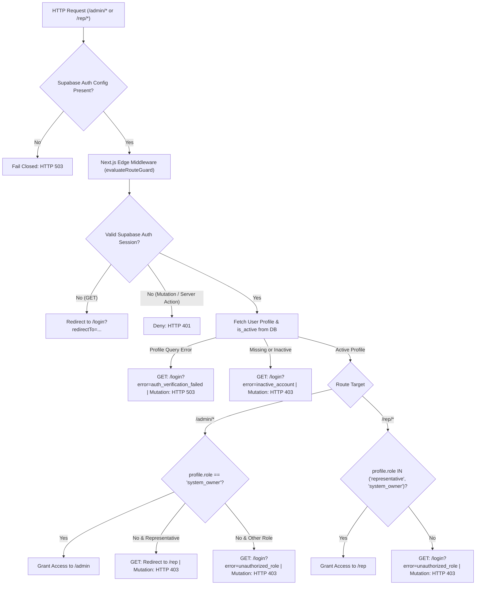

# HU-ASMS: Administrative Web Dashboard Architecture (Phase 11)

## 1. Overview

The **Administrative Web Dashboard** (`apps/web`) provides a centralized, secure web interface for the Haramaya University Academic Submission Management System (HU-ASMS). Built with Next.js 14+ (App Router), TypeScript, and Tailwind CSS, the platform delivers dual-persona administrative consoles:
1. **System Owner (Super Admin) Console (`/admin`)**: Institutional management of organizational structure, courses, teachers, projects, registration approvals, representative assignments, and audit logs.
2. **Section Representative Console (`/rep`)**: Partitioned workspace restricted to assigned sections for submission monitoring, group confirmation tracking, signed file downloads, and compliance reporting.

---

## 2. Security Architecture & Role Guards

### 2.1 Canonical Role Model & Fail-Closed Guards
- **Canonical Database Roles**: Only `'system_owner'` and `'representative'` grant administrative portal access. Legacy `'owner'` values are rejected (`isSystemOwnerRole`, `isRepresentativeRole`, and `resolvePostLoginPath` in `apps/web/src/lib/auth/role-policy.ts`).
- **Active Account & Assignment Enforcement**: Profiles must have `is_active = true`, and representative section scope requires active `representative_assignments` rows (`auth_is_rep_for_section` / `auth_get_assigned_section_ids` in Supabase RLS and `resolveUserSessionContext` / `getActiveAssignedSectionIds` / direct `is_active === true` verification inside `assertSystemOwner`, `assertRepresentativeSectionScope`, and `resolveAuthorizedSectionScope`).
- **Fail-Closed Edge Middleware**: `evaluateRouteGuard` (`apps/web/src/lib/auth/middleware-guard.ts`) fails closed on missing Supabase configuration (`503`), profile query failures, inactive profiles, and unauthenticated or unauthorized mutations/Next.js Server Actions (`401`/`403`/`503`).
- **Defense-in-Depth Page & Service Guards**: Server Components call `ensureSystemOwnerPage` (`/admin/*`) or `ensureRepresentativePage` (`/rep/*`), and administrative mutation services (`executeApproveRegistration`, `executeRejectRegistration`, `executeGetSubmissionFileDownloadUrl`, `executeGetDeliveryPackageManifest`) enforce server-side role/scope assertions, UUID validation, relation integrity checks, and rate limiting.
- **Documented Follow-Up Architecture Proposals**: See `docs/SECURITY_AND_HARDENING.md` Section 5 (shared distributed rate limiter replacement for process-local `globalWebRateLimiter`) and Section 6 (atomic PostgreSQL `approve_student_registration` RPC proposal replacing the current two-write approval sequence).

### 2.2 Secret Hygiene & Client Protection
- **No Service Role Keys in Client Code**: Client components and browser utilities strictly consume `NEXT_PUBLIC_SUPABASE_URL` and `NEXT_PUBLIC_SUPABASE_ANON_KEY`.
- `SUPABASE_SERVICE_ROLE_KEY` and `TELEGRAM_BOT_TOKEN` are never imported, bundled, or exposed to the browser (enforced and verified by automated static analysis in `apps/web/test/secret-hygiene.test.ts`).
- Server components and server actions pass authenticated user session cookies to Supabase, guaranteeing that PostgreSQL Row Level Security (RLS) policies enforce database-level authorization on all queries.

---

## 3. System Owner Console Modules (`/admin`)

| Module Path | Features & Operational Responsibilities |
| :--- | :--- |
| **`/admin`** | **Telemetry Dashboard**: System-wide KPI counters (students, pending registrations, active projects, submissions, representatives), recent registration requests queue, and recent security audit events. |
| **`/admin/structure`** | **University Structure**: Dynamic CRUD for Departments, Academic Years, and Sections. Status toggling (`is_active`). Zero hardcoding. |
| **`/admin/academics`** | **Academic Directory**: Dynamic course registry (code, title, department) and teacher directory with contact info (email, phone, Telegram ID). |
| **`/admin/academics/projects`** | **Project Studio**: Project creator with multi-scope targeting (years and sections), deadline pickers, file constraints (extensions, MIME, size), and group size bounds. |
| **`/admin/students`** | **Student Identity Lifecycle**: First-time registration approval/rejection queue (`registration_requests`), identity correction reviews, account suspension controls, and university-wide roster browser. |
| **`/admin/representatives`** | **Representative Assignments**: Assigning and revoking representatives across single or multiple academic sections, linking Telegram numeric IDs, and deactivating profiles. |
| **`/admin/audit-logs`** | **Audit Trail**: Complete chronological timeline of all security, identity, submission, and administrative events with metadata inspection. |

---

## 4. Section Representative Console Modules (`/rep`)

| Module Path | Features & Operational Responsibilities |
| :--- | :--- |
| **`/rep`** | **Scope Overview**: Multi-section switcher for representatives assigned to multiple sections (e.g. 2A & 2B), progress summaries, and submission KPIs. |
| **`/rep/students`** | **Section Roster**: Enrolled students strictly restricted to assigned sections, displaying HU Student IDs, registration locking status, and Telegram linkage. |
| **`/rep/submissions`** | **Submissions & File Vault**: Individual and group submissions received in scope. Includes version numbers (`v1`, `v2`), submitter names, and credited team member snapshots. |
| **`/rep/submissions` (Actions)** | **Signed File Download**: Server action `getSubmissionFileDownloadUrl` verifies representative section authorization and generates temporary 15-minute pre-signed URLs from the private `submission-files-vault` bucket. Direct public URLs are never exposed. |
| **`/rep/groups`** | **Group Verification Console**: Pre-created group monitor tracking independent member confirmation states (`confirmed`, `pending`, `declined`). Displays diagnostic lists of pending students blocking group verification. |
| **`/rep/reports`** | **Compliance Reports**: High-fidelity submission progress, submitted artifact details, missing student rosters with registration status, and project-by-project breakdown. |

---

## 5. Verification & Test Evidence

- **Web Unit Tests (`apps/web/test/`)**: 15 tests passed across 3 test suites:
  - Role resolution and guard tests (`auth-roles.test.ts`): 10 tests passed
  - Secret hygiene scanner (`secret-hygiene.test.ts`): 2 tests passed
  - Signed download URL security (`signed-url.test.ts`): 3 tests passed
- **Full Workspace Test Suite**: 93 tests passed across 34 test suites with **86.95% overall line coverage**.
