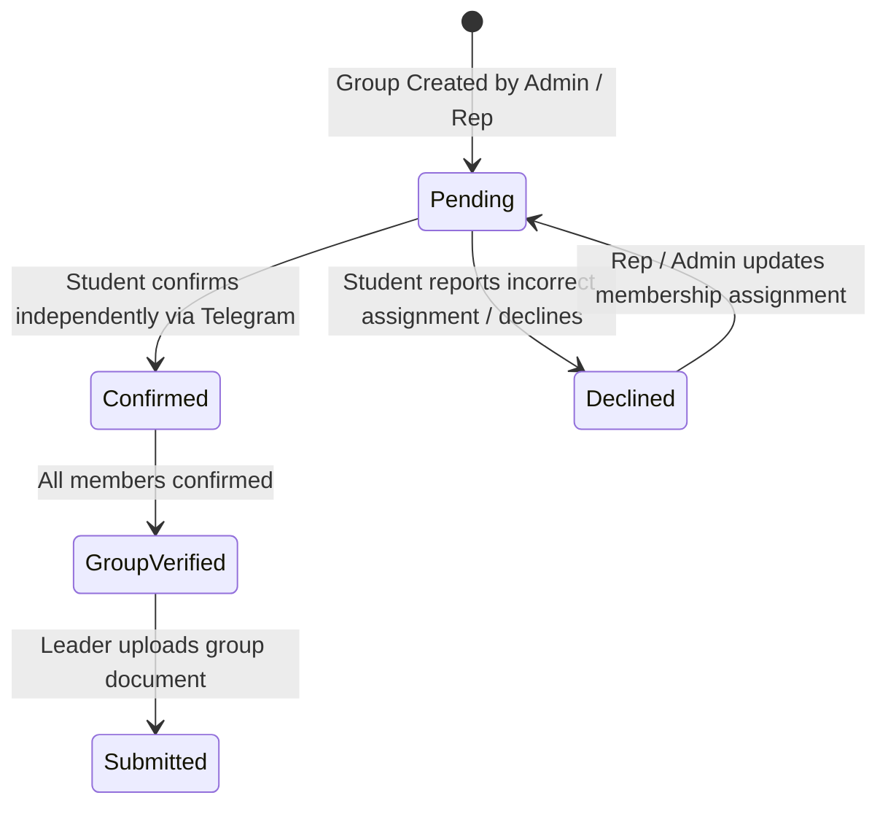

# HU-ASMS: Group Management & Membership Verification Architecture

## 1. Overview

In the Haramaya University Academic Submission Management System (HU-ASMS), group work is managed through a pre-creation and independent membership verification process.

```
Project (e.g. Software Engineering Term Project)
  └── Groups (e.g. Group 01 for Section B)
       ├── Group Leader (Authorized Submitter)
       └── Group Members
            ├── Member 1 (HU/10294/14) -> Confirmed
            └── Member 2 (HU/10295/14) -> Pending / Confirmed / Declined
```

---

## 2. Key Architectural Rules

1. **Pre-Creation Requirement**:
   - Groups must be created in the database before any group submissions begin.
   - Group records belong strictly to a specific `project_id`, `academic_year_id`, and `section_id`.
2. **Non-Global Group Numbers**:
   - Group numbers/codes (e.g. `Group 01`) are unique within `(project_id, section_id)`, but can be reused across different projects.
3. **Single Active Group Per Student Per Project**:
   - Database trigger `trg_enforce_single_group_per_project` and `GroupManagementService` guarantee that a student cannot be assigned to multiple groups for the same project.
4. **Scope-Enforced Membership**:
   - Only registered, approved students belonging to the targeted academic section can be assigned as members. Cross-section assignments are prohibited unless authorized by the System Owner.
5. **Independent Membership Confirmation**:
   - Every assigned member must independently interact with the Telegram bot via `👥 My Groups` or `/groups`.
   - A student cannot confirm or decline membership on behalf of another student.
6. **Group Verification State Machine**:
   - `pending`: One or more members have not yet confirmed, or at least one member declined.
   - `verified`: **All** required members have confirmed. Only verified groups are eligible for final submission.
   - `submitted`: Final submission has been uploaded by the group leader.
   - `cancelled`: Group cancelled by administration.

---

## 3. Membership State Machine



---

## 4. Group Representative & Submitter Permissions

- **Project-Specific Scope**: Being a group leader or representative is strictly project-specific and grants zero administrative access to other groups or other academic sections.
- **Sole Submitter Principle**: Only the authorized group leader can upload the group's final document during submission (Phase 09).
