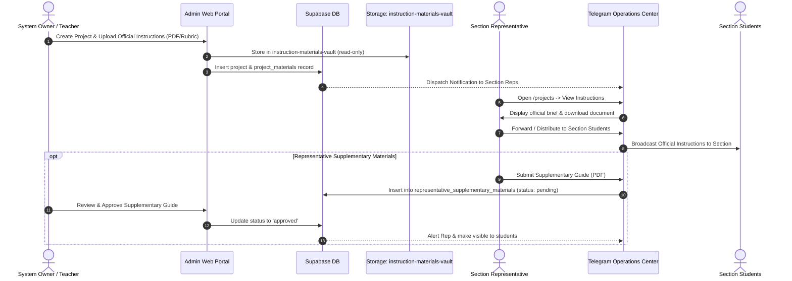
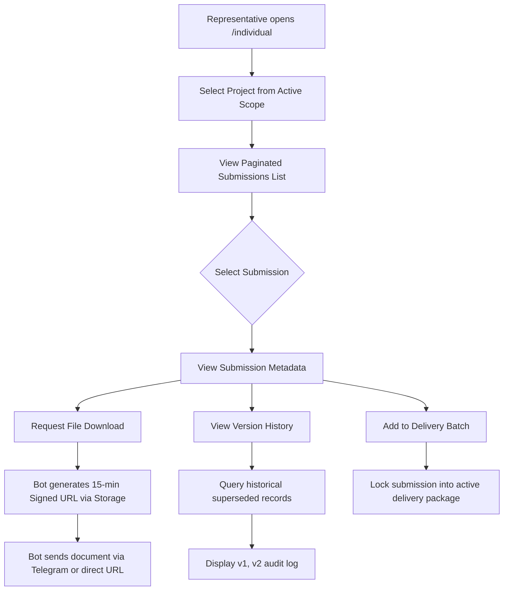
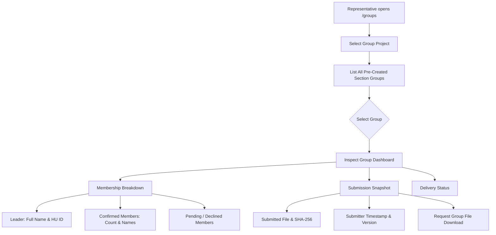
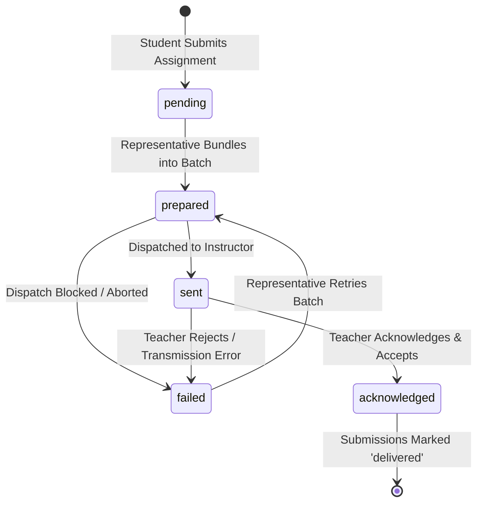
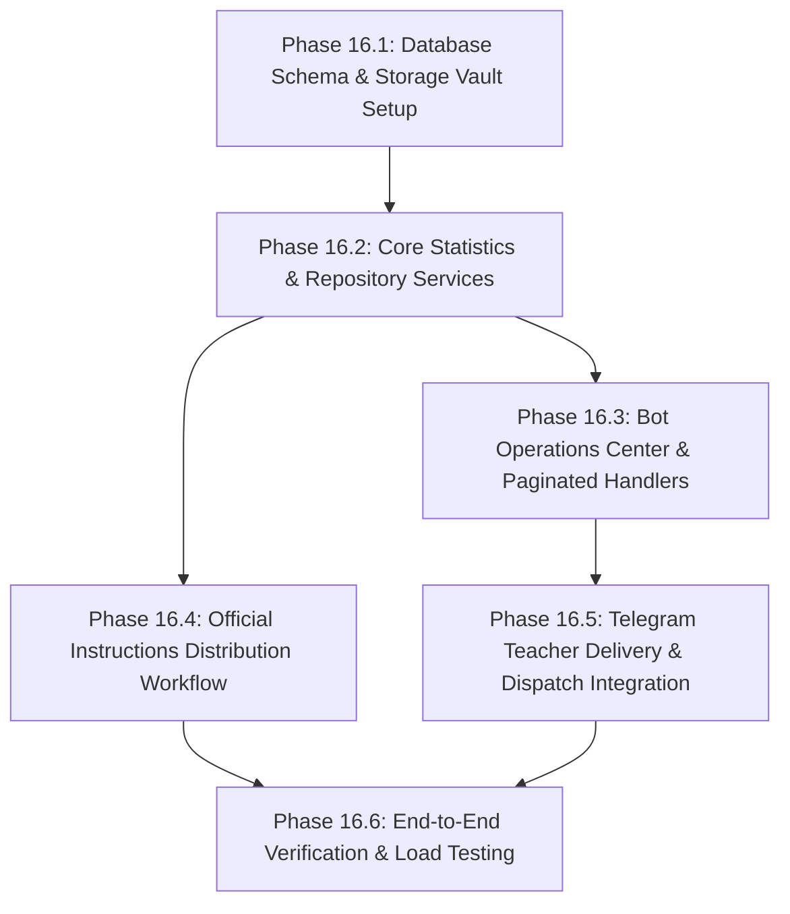

# HU-ASMS — Phase 16: Representative Academic Operations Center
## Comprehensive Architecture, Requirements & Security Audit Design

**Document Status**: `READY FOR IMPLEMENTATION APPROVAL`  
**Execution Mode**: READ-ONLY AUDIT & DESIGN (No code, database, migration, or webhook modifications applied)  
**Target Project**: `tkdrxfvxryemfdrwcmay`  
**Date**: November 13, 2026  
**Auditor**: Antigravity DeepMind Agent  

---

## 1. Current Implementation Inventory

A comprehensive forensic inspection of the repository was conducted across `@hu-asms/bot`, `@hu-asms/web`, `@hu-asms/database`, and Supabase schema/migrations.

### Component Matrix

| Area | Component | Current Implementation | Files / References |
|---|---|---|---|
| **Bot Handlers** | Representative Commands & Menus | Basic read-only text reports and section student listing. Delivery forward handler merely prints a web link to `/rep/deliveries/new`. No Telegram file viewing or delivery actions. | `apps/bot/src/handlers/representative.handler.ts`<br>`apps/bot/src/keyboards/main-menu.ts`<br>`apps/bot/src/bot.ts` |
| **Bot Services** | Representative Scope & Reporting | `RepresentativeService` and `RepresentativeReportingService` implement scope assertions (`assertSectionScope`), student/project listing, and JSON report generation. | `apps/bot/src/services/representative.service.ts`<br>`apps/bot/src/services/representative-reporting.service.ts` |
| **Web Portal** | Representative Dashboard | Complete web portal for representatives: submissions table, signed URL file downloads, group pre-creation, delivery package preparation, dispatch, acknowledgment, and failure handling. | `apps/web/src/app/rep/`<br>`apps/web/src/lib/rep/delivery-service.ts`<br>`apps/web/src/lib/rep/submission-file-service.ts` |
| **Project Schema** | Academic Projects & Targets | `projects`, `courses`, `teachers`, `project_targets`, and `project_file_rules` tables exist in PostgreSQL. Handles dates, allowed extensions, file sizes, and group sizes. | `supabase/migrations/20261110000001_initial_schema.sql`<br>`packages/database/src/academic-management.ts` |
| **Instructions** | Project Instructions & Materials | **MISSING**. Only `projects.description` (plain text) exists. No tables, storage buckets, or UI for official instruction files, rubrics, or representative supplementary materials. | `projects.description` only |
| **Storage Vault** | Private File Vault | `submission-files-vault` storage bucket is private. Representatives can download files strictly within assigned section scopes via 15-minute signed URLs. | `supabase/migrations/20261110000003_storage_setup.sql`<br>`apps/web/src/lib/rep/submission-file-service.ts` |
| **Database RLS** | Row-Level Security | Strict policies enforce `auth_is_rep_for_section(section_id)` on `submissions`, `submission_files`, `groups`, `group_members`, `deliveries`, and `delivery_items`. | `supabase/migrations/20261110000002_row_level_security.sql` |

---

## 2. Existing Working Features

1. **Representative Scope Enforcement**:
   - `assertRepresentativeSectionScope` in Next.js web application strictly enforces that a representative can only view or act on records belonging to their active assigned sections.
   - `assertSectionScope` in `RepresentativeService` and `RepresentativeReportingService` provides scope guards in the bot process.
   - Immediate deactivation: When `representative_assignments.is_active` is set to `false`, access is immediately revoked across both the web portal (RLS) and Telegram bot.
2. **Web Representative Submissions & Vault**:
   - Representatives can view all submissions in their assigned section at `/rep/submissions`.
   - Secure temporary signed URL generation (15-minute TTL) for private storage downloads via `getSubmissionFileDownloadUrl`.
   - Submissions distinguish between individual and group modes with versioning (`v1`, `v2`).
3. **Web Delivery State Machine**:
   - Preparation: `executePrepareDeliveryBatch` validates active submissions, guards against duplicate inclusion across active batches, and binds to assigned teachers.
   - Dispatch: `mark_delivery_sent_with_audit` transitions batch to `sent` with audit logging.
   - Acknowledgment: `executeAcknowledgeDelivery` transitions delivery to `acknowledged` and atomically marks underlying submissions as `delivered`.
   - Failure: `executeFailDelivery` transitions broken batches to `failed` with failure reasons.
4. **Group Management & Pre-creation**:
   - Group pre-creation by representative in `/rep/groups/new` with code uniqueness constraints per project and section (`uq_group_code_project_section`).
   - Group member confirmation workflow (`pending`, `confirmed`, `declined`) with database triggers.
5. **Basic Bot Reporting**:
   - `/reports` displays individual and group completion percentages, submitted students/teams, and missing rosters in Markdown format.

---

## 3. Missing Features (Gaps Identified)

1. **No Telegram Operations Center**:
   - The Telegram bot currently lacks a unified operational dashboard for representatives.
   - Quick menu buttons are limited to 7 items and do not cover incoming submissions, not-submitted lists, direct file access, or delivery execution.
2. **No Telegram-Based Submission & File Access**:
   - Representatives cannot inspect individual or group submission details inside Telegram.
   - Representatives cannot download or view submitted files in Telegram (they are told to open the web portal).
3. **No Telegram-Based Delivery Preparation & Dispatch**:
   - `handleRepForwardToTeacher` in the bot only outputs a text link to `/rep/deliveries/new`. A representative cannot prepare, review, dispatch, or retry deliveries from Telegram.
4. **No Official Project Instructions & Materials Distribution**:
   - No mechanism exists for administrators or teachers to upload official syllabus files, rubrics, or assignment packages.
   - Representatives cannot access official instruction documents or distribute them to section students.
   - Representatives have no workflow to submit supplementary study guides or templates for administrator review.
5. **No Pagination or Search in Bot Rosters**:
   - `displaySectionRoster` dumps all students in a single message. For large university sections (60–100 students), this exceeds Telegram's 4,096-character limit, resulting in silent message failure or bot crashes.
   - No search functionality exists for representatives to look up a student by HU ID or name.
6. **No Multi-Scope Session Switcher**:
   - If a representative manages two sections (e.g., Section A and Section B), commands either dump both sections together or require picking a section on every step. There is no concept of an "Active Section Scope" stored in the bot session.

---

## 4. Recommended Telegram Representative Menu

To provide a comprehensive academic operations center without granting administrative access, the bot must implement a structured, role-scoped keyboard and command hierarchy.

### Main Operations Keyboard Layout

```
┌─────────────────────────────────┬─────────────────────────────────┐
│  📊 Operations Dashboard        │  🏢 My Assigned Sections        │
├─────────────────────────────────┼─────────────────────────────────┤
│  👥 My Students                 │  📂 My Projects                 │
├─────────────────────────────────┼─────────────────────────────────┤
│  📥 Incoming Submissions        │  ✅ Submitted Students          │
├─────────────────────────────────┼─────────────────────────────────┤
│  ❌ Not Submitted Students      │  👤 Individual Assignments      │
├─────────────────────────────────┼─────────────────────────────────┤
│  👥 Group Assignments           │  📦 Teacher Delivery            │
├─────────────────────────────────┼─────────────────────────────────┤
│  📜 Delivery History            │  📈 Academic Reports            │
├─────────────────────────────────┼─────────────────────────────────┤
│  🔄 Switch Active Scope         │  ❓ Help & Support              │
└─────────────────────────────────┴─────────────────────────────────┘
```

### Menu Actions & Handler Specifications

| Menu Button | Command | Access Scope & Behavior |
|---|---|---|
| **📊 Operations Dashboard** | `/dashboard` | Displays real-time metrics for the active section: enrolled students, active projects, overall submission rate, pending deliveries, and deadline alerts. |
| **🏢 My Assigned Sections** | `/sections` | Lists all sections assigned to the representative. Displays active scope badge and allows quick switching. |
| **👥 My Students** | `/students` | Paginated roster of enrolled students in active section with search, registration status, lock icon, and Telegram link status. |
| **📂 My Projects** | `/projects` | Active projects targeted at the representative's section. Shows title, course, teacher, deadline, rules, and download link for official instructions. |
| **📥 Incoming Submissions** | `/incoming` | Real-time queue of recent submissions awaiting representative review before batching. |
| **✅ Submitted Students** | `/submitted` | Filter by project: displays students/teams who have valid active submissions, submission timestamps, version, and delivery status. |
| **❌ Not Submitted Students** | `/missing` | Filter by project: displays eligible students who have NOT submitted. Includes direct button to copy broadcast reminder. |
| **👤 Individual Assignments**| `/individual`| Drill-down into individual project submissions: inspect metadata, view file SHA-256, request 15-min signed download URL or Telegram document. |
| **👥 Group Assignments** | `/groups` | Manage section groups: inspect confirmed members, pending invites, group leader, and submitted group packages. |
| **📦 Teacher Delivery** | `/delivery` | Operations console: select project, view un-batched submissions, prepare delivery batch, and dispatch to assigned teacher. |
| **📜 Delivery History** | `/history` | Audited log of all delivery batches: status (`prepared`, `sent`, `failed`, `acknowledged`), recipient teacher, and error retry options. |
| **📈 Academic Reports** | `/reports` | Formatted summary and JSON export of submission statistics. |
| **🔄 Switch Active Scope** | `/scope` | If assigned to >1 section, toggles active session scope (`session.activeSectionId`). If only 1 section, displays confirmation. |
| **❓ Help & Support** | `/help` | Operational guidelines, SLA deadlines, escalation contacts for System Owner. |

### Identity & Multi-Scope Rules
1. **Zero Trust on Username**: Authentication and authorization strictly resolve `ctx.from.id` (Telegram numeric ID) against `profiles.telegram_user_id` and `representative_assignments`. If a user changes their Telegram username, permissions remain intact.
2. **Active Scope Context**:
   - `session.activeSectionId` stores the selected section UUID.
   - If a representative has exactly 1 section, it is locked automatically.
   - If a representative has multiple sections, every view displays `[Scope: Year 3 — Section A]`. Tapping `🔄 Switch Active Scope` presents an inline button grid to change active scope instantly.

---

## 5. Official Project Instructions & Materials Distribution

### Existing Implementation Analysis
Currently, project creation is modeled via `createProject` in `packages/database/src/academic-management.ts`. The schema contains:
- `projects.title` (string)
- `projects.description` (text)
- `projects.course_id` (foreign key to `courses`)
- `projects.teacher_id` (foreign key to `teachers`)
- `projects.opening_date` & `projects.deadline` (timestamps)
- `projects.submission_type` (`individual`, `group`, `both`)
- `project_file_rules` (allowed extensions, max file size, group capacity)
- `project_targets` (academic year and section mapping)

**Deficiencies**:
1. No capability exists to upload official assignment PDFs, lab manuals, datasets, or rubrics.
2. `projects.description` is a single plain-text field, inadequate for university-level instructions.
3. No workflow exists for representatives to receive or broadcast official instructions.
4. Representatives cannot submit section-specific supplementary materials (e.g., tutorial guides, Ethiopian calendar conversion notes) for administrator review.

### Proposed Architecture & Workflow



### Safety & Governance Rules
1. **Immutability of Official Instructions**: Representatives **CANNOT** edit, alter, replace, or delete official project instructions, deadlines, submission rules, or assigned teachers. Any alteration must be rejected server-side.
2. **Supplementary Materials Gate**: Any supplementary materials submitted by representatives must enter a `status: 'pending'` approval queue. They are NOT visible to students until a System Owner or teacher approves them in the web portal.

---

## 6. Project-Wise Submission Statistics Definitions

To ensure consistent reporting across the Next.js dashboard and Telegram bot, the following mathematical and relational definitions must be enforced:

### Mathematical Definitions

1. **Eligible Students Count ($N_{eligible}$)**:
   $$\text{Eligible Students} = \{ s \in \text{Students} \mid s.\text{section\_id} = \text{SectionId} \land s.\text{registration\_status} = \text{'locked'} \land s.\text{is\_locked} = \text{true} \land s.\text{status} \neq \text{'suspended'} \}$$
   - *Exclusions*: Unapproved students (`pending`), rejected students, and suspended accounts are strictly excluded.

2. **Submitted Students Count ($N_{submitted}$)**:
   - **For Individual Projects**:
     $$\{ s \in \text{Eligible} \mid \exists sub \in \text{Submissions}(sub.\text{student\_id} = s.\text{id} \land sub.\text{project\_id} = \text{ProjId} \land sub.\text{status} = \text{'active'}) \}$$
   - **For Group Projects**:
     $$\{ s \in \text{Eligible} \mid \exists sub \in \text{Submissions}, gm \in \text{GroupMembers}(sub.\text{group\_id} = gm.\text{group\_id} \land gm.\text{student\_id} = s.\text{id} \land gm.\text{confirmation\_status} = \text{'confirmed'} \land sub.\text{status} = \text{'active'}) \}$$
     *Rule*: Every confirmed member of a submitted group is credited as submitted. Unconfirmed or declined members remain uncredited.
   - **For 'Both' Projects**:
     Union of individual submitters and group confirmed members.

3. **Not Submitted Students Count ($N_{missing}$)**:
   $$N_{missing} = N_{eligible} - N_{submitted}$$

4. **Individual Submission Count ($C_{ind}$)**:
   Total active rows in `submissions` where `submission_type = 'individual' AND status = 'active'`.

5. **Group Submission Count ($C_{grp}$)**:
   Total active rows in `submissions` where `submission_type = 'group' AND status = 'active'`.  
   *Rule*: One group submission equals **1** submission count, regardless of whether the group contains 2, 5, or 10 students.

6. **Pending Delivery Count ($C_{pending\_del}$)**:
   Active submissions ($sub.\text{status} = \text{'active'}$) that are **not** referenced by any `delivery_items` linked to a delivery with $\text{status} \in \{\text{'prepared'}, \text{'sent'}, \text{'acknowledged'}\}$.

7. **Successfully Sent Count ($C_{sent\_del}$)**:
   Submissions included in deliveries where $\text{status} \in \{\text{'sent'}, \text{'acknowledged'}\}$.

8. **Failed Delivery Count ($C_{failed\_del}$)**:
   Deliveries where $\text{status} = \text{'failed'}$.

9. **Project Lifecycle Status**:
   - `Upcoming`: $\text{now} < \text{opening\_date}$
   - `Open`: $\text{opening\_date} \le \text{now} \le \text{deadline} \land \text{is\_active} = \text{true}$
   - `Past Deadline`: $\text{now} > \text{deadline} \land \text{is\_active} = \text{true}$
   - `Closed / Inactive`: $\text{is\_active} = \text{false}$

---

## 7. Submitted vs. Not Submitted Logic

### Submitted List Specification
- **Filter**: Active section, selected project, status = `submitted`.
- **Fields Displayed**:
  1. Student Full Name (or Group Code + Member Names)
  2. HU Student ID (`ETS xxxx/yy`)
  3. Submission Timestamp (formatted in UTC and East Africa Time)
  4. Submission Type (`👤 Individual` vs `👥 Group`)
  5. Version indicator (`v1`, `v2 (Resubmitted)`)
  6. File attachment metadata: Original filename, formatted file size, checksum validation badge
  7. Delivery State badge: `⚪ Un-batched` / `🟡 Prepared` / `🔵 Sent` / `🟢 Acknowledged`
- **Actions**: `[View Details]`, `[Request File Download]`, `[Submission History]`

### Not Submitted List Specification
- **Filter**: Active section, selected project, status = `missing`.
- **Fields Displayed**:
  1. Student Full Name
  2. HU Student ID
  3. Telegram Link Status: `📱 Linked` vs `⚠️ No Telegram Account`
  4. Account Status: `Approved (Locked)`
- **Actions**:
  - `[Send Direct Reminder]`: Sends an automated notification to the student's linked Telegram chat reminding them of the upcoming project deadline.
  - `[Copy Missing List]`: Copies a formatted roster of missing HU IDs to clipboard for posting in official university notice channels.

### Pagination & Search Safeguards
- Telegram messages must not exceed 4,096 characters.
- Rosters must paginate at **10 students per page**.
- Interactive inline keyboard: `[◀️ Prev 10] [Page 1/4] [Next 10 ▶️]`
- Search action: Representative sends `/search <HU-ID or Name>` to filter students within the active section scope instantly.

---

## 8. Individual Assignment Access Workflow



### Privacy & Access Controls
1. **Section Isolation**: Representative can ONLY view individual submissions where `submissions.section_id = activeSectionId`.
2. **Zero Direct Storage Exposure**: Raw Supabase storage URLs are never exposed. Short-lived signed URLs (900-second TTL) or direct Telegram file forwarding (`telegram_file_id`) are used.
3. **Audit Trail**: Every file access request by a representative writes an audit log:
   `action: 'REPRESENTATIVE_FILE_ACCESSED'`, `entity_type: 'submission_file'`, `actor_telegram_id: ctx.from.id`.

---

## 9. Group Assignment Access Workflow



### Critical Group Rules
1. **One Group Submission = One File**: A group of 5 students generates exactly **one** submission record and **one** storage object. The system must never duplicate records per member.
2. **Snapshot Integrity**: The `submission_members` table captures an immutable snapshot of confirmed members at the moment of submission. If group membership is altered after submission, the submitted snapshot remains historically accurate.
3. **Pre-creation Integrity**: Representatives can view membership status (`pending`, `confirmed`, `declined`), but cannot alter student confirmation statuses (each student must confirm their own membership).

---

## 10. Teacher Delivery Workflow

### Delivery State Machine



### Exact State Definitions

| Status | Meaning | Permitted Actor | Transitions Allowed |
|---|---|---|---|
| `pending` | Submission received and validated, stored in vault, waiting for representative delivery batching. | System | $\to$ `prepared` |
| `prepared` | Representative has bundled verified submissions into a delivery package for a specific project and course. Items are locked against duplicate batching. | Representative | $\to$ `sent`, $\to$ `failed`, $\to$ `deleted` (cancel) |
| `sent` | Representative has dispatched the package to the official instructor via Telegram, email, or in-person transfer. **Does NOT imply teacher acceptance.** | Representative | $\to$ `acknowledged`, $\to$ `failed` |
| `failed` | Dispatch failed due to network timeout, blocked Telegram bot, invalid teacher destination, or instructor rejection. Failure reason must be recorded. | Representative / System | $\to$ `prepared` (retry) |
| `acknowledged` | Teacher has formally confirmed receipt, verified file integrity, and accepted the submission batch. Underlying submissions transition to `delivered`. | Teacher / Representative | Final State |

### Teacher Destination Governance
- **Strict Configuration Integrity**: The target teacher is strictly retrieved from `projects.teacher_id` $\to$ `teachers`.
- **Zero Representative Override**: Representatives are **strictly prohibited** from specifying an arbitrary teacher, altering the recipient email, or modifying the target Telegram ID.
- **Dispatch Channel**: If `teachers.telegram_user_id` is populated, the bot can dispatch the package directly via Telegram. If not configured, the bot outputs the verified institutional email and signed manifest download link.

---

## 11. Security and Authorization Audit

### Audit Findings Matrix

| Security Guard | Layer | Enforcement Mechanism | Status |
|---|---|---|---|
| **Representative Role Check** | Application & DB | `profiles.role = 'representative' AND profiles.is_active = true` | **ENFORCED** |
| **Section Scope Isolation** | DB (RLS) | `auth_is_rep_for_section(section_id)` restricts SELECT, INSERT, UPDATE on web. | **ENFORCED (Web)** |
| **Bot Service Scope Isolation** | Bot Application | `assertSectionScope(telegramUserId, sectionId)` in `RepresentativeService`. | **ENFORCED (Existing handlers)** |
| **Cross-Section Query Leakage** | Database RPC / Queries | Handlers must strictly filter by `section_id = activeSectionId`. | **AUDIT WARNING** (See Red Flag 1) |
| **Storage Object Access** | Supabase Storage RLS | `representative_read_storage_objects` checks `auth_is_rep_for_section` on bucket. | **ENFORCED (Web)** |
| **Bot File Retrieval Security** | Bot Service | Bot currently lacks file download handler; must enforce scope before generating signed URLs. | **GAP** (Must be designed) |
| **Teacher Destination Locking** | Database Foreign Key | `deliveries.teacher_id` must match `projects.teacher_id`. | **ENFORCED** |
| **Deactivation Revocation** | Triggers & RLS | Setting `representative_assignments.is_active = false` terminates privileges immediately. | **ENFORCED** |
| **Audit Logging** | PostgreSQL table | `audit_logs` records actor ID, action, entity, metadata, and timestamp. | **ENFORCED** |

---

## 12. RED FLAGS — Architectural & Security Blockers

### RED FLAG 1 [CRITICAL]: Service-Role Client in Bot Bypasses PostgreSQL Row-Level Security
- **Affected File/Function**: `apps/bot/src/bot.ts`, `apps/bot/src/handlers/representative.handler.ts`
- **Evidence**: The Telegram bot initializes via `getSupabaseAdminClient()`, which uses `SUPABASE_SERVICE_ROLE_KEY`. PostgreSQL RLS is completely bypassed in the bot process.
- **Actual Behavior**: The database cannot enforce `auth_is_rep_for_section` on bot queries because `auth.uid()` is null. Scope isolation relies entirely on TypeScript code calling `assertSectionScope`.
- **Risk**: If any new Telegram handler queries `submissions`, `students`, or `deliveries` without calling `assertSectionScope`, student data across the entire university is leaked to the representative.
- **Proposed Correction**: Wrap all database queries in a hardened `RepresentativeScopedRepository` that automatically attaches `WHERE section_id = :activeSectionId` to every single database query and throws an unhandled scope error if `section_id` is omitted.

---

### RED FLAG 2 [CRITICAL]: Telegram Message Size Overflow on Section Rosters (4096-char Limit)
- **Affected File/Function**: `apps/bot/src/handlers/representative.handler.ts` -> `displaySectionRoster`
- **Evidence**:
  ```ts
  let msg = `📋 *Section Roster: ${scopeName}* (${students.length} Students)\n...`;
  students.forEach((s, idx) => {
    msg += `${idx + 1}. *${s.full_name}*\n   HU ID: \`${s.hu_student_id}\` ...`;
  });
  await ctx.reply(msg, { parse_mode: 'Markdown' });
  ```
- **Actual Behavior**: If a section has 50–100 students, `msg` exceeds 4,096 characters.
- **Risk**: The Telegram API rejects the message with `400 Bad Request: message is too long`. The representative sees nothing and the command crashes.
- **Proposed Correction**: Implement mandatory pagination: chunk rosters into pages of 10 students with inline navigation buttons (`rep_roster_page_<sectionId>_<page>`).

---

### RED FLAG 3 [HIGH]: Absence of Project Instructions & Reference Materials Tables in Schema
- **Affected File/Function**: `supabase/migrations/20261110000001_initial_schema.sql`, `projects` table
- **Evidence**: `projects` table contains only `description TEXT`. There is no table for project instruction documents, no storage bucket for course reference materials, and no table for representative supplementary submissions.
- **Actual Behavior**: Official instructions can only be communicated as short unformatted strings. PDFs, assignment templates, and rubrics cannot be stored or distributed.
- **Risk**: Inability to fulfill Phase 16 requirement for official instruction distribution and supplementary material submission.
- **Proposed Correction**: Propose schema additions for `project_instructions`, `project_reference_materials`, and `representative_supplementary_materials` (see Section 14).

---

### RED FLAG 4 [HIGH]: Unverified Teacher Telegram Accounts Pose Misdirection Risk
- **Affected File/Function**: `supabase/migrations/20261110000001_initial_schema.sql` -> `teachers.telegram_user_id`
- **Evidence**: `teachers.telegram_user_id` is an unverified `BIGINT` column entered manually by administrators.
- **Actual Behavior**: If an administrator inputs an incorrect Telegram ID, confidential student exam submissions and project files would be forwarded to an unauthorized third party upon delivery dispatch.
- **Risk**: Serious student PII and academic confidentiality breach.
- **Proposed Correction**: Require cryptographic handshake or claim-token verification for teachers before activating Telegram delivery forwarding (similar to student verification). If unverified, fallback to authenticated email dispatch.

---

### RED FLAG 5 [MEDIUM]: Stale In-Memory Active Scope Across Bot Cold Starts
- **Affected File/Function**: `apps/bot/src/bot.ts` -> Session storage
- **Evidence**: `session` stores conversation state, but there is no persistent database table recording a representative's currently selected section scope.
- **Actual Behavior**: When serverless instances recycle or bot restarts, active section scope reverts to the default first section, potentially causing representatives with multiple sections to perform actions in the wrong section unintentionally.
- **Risk**: Usability friction and potential misattribution of batch preparations.
- **Proposed Correction**: Persist `active_section_id` in `representative_assignments.is_current_scope` or in the persistent Supabase session table.

---

### RED FLAG 6 [LOW]: Inline Keyboard Callback Query Data Limit (64 Bytes)
- **Affected File/Function**: `apps/bot/src/handlers/representative.handler.ts` -> Callback query patterns
- **Evidence**: Callback data strings such as `rep_report_${assign.section_id}_${proj.id}` concatenate two 36-character UUIDs with prefixes (total > 80 characters).
- **Actual Behavior**: Exceeds Telegram's 64-byte `callback_data` limit, causing Telegram Bot API to throw `BUTTON_DATA_INVALID`.
- **Risk**: Buttons fail to register or trigger actions.
- **Proposed Correction**: Use short session keys, integer indexes, or 8-character hashed IDs in `callback_data` rather than concatenating multiple full UUIDs.

---

## 13. Proposed Code Files & Functions Requiring Changes

*(No changes have been made. These are proposed specifications for subsequent implementation).*

### 1. Telegram Bot Application (`@hu-asms/bot`)

| File Path | Nature | Proposed Modifications |
|---|---|---|
| `apps/bot/src/keyboards/main-menu.ts` | Edit | Replace `getRepresentativeMainMenuKeyboard` with the comprehensive 13-button Operations Center keyboard. |
| `apps/bot/src/handlers/representative.handler.ts` | Major Overhaul | Add handlers for `/dashboard`, `/submitted`, `/missing`, `/individual`, `/groups`, `/delivery`, `/history`, and `/scope`. Implement paginated roster rendering. |
| `apps/bot/src/services/representative-operations.service.ts` | **NEW File** | Dedicated service implementing the exact mathematical calculations from Section 6, un-batched submission queries, and delivery preparation inside the bot. |
| `apps/bot/src/conversations/rep-delivery.conversation.ts` | **NEW File** | Interactive grammY conversation guiding the representative through: selecting un-batched submissions, reviewing batch manifest, and confirming dispatch to instructor. |
| `apps/bot/src/utils/callback-data-codec.ts` | **NEW File** | Compact encoder/decoder to fit UUID pairs into Telegram's 64-byte `callback_data` limit. |

### 2. Next.js Web Application (`@hu-asms/web`)

| File Path | Nature | Proposed Modifications |
|---|---|---|
| `apps/web/src/app/admin/academics/projects/page.tsx` | Edit | Add UI to upload official project instruction documents and view representative supplementary materials. |
| `apps/web/src/app/admin/academics/projects/actions.ts` | **NEW File** | Server actions to upload official instructions and approve/reject representative supplementary materials. |
| `apps/web/src/app/rep/instructions/page.tsx` | **NEW File** | Representative portal page to view official instructions, download rubrics, and upload supplementary study guides. |

### 3. Shared & Types Packages (`@hu-asms/types`, `@hu-asms/shared`)

| File Path | Nature | Proposed Modifications |
|---|---|---|
| `packages/types/src/index.ts` | Edit | Export interfaces for `ProjectInstruction`, `SupplementaryMaterial`, `ProjectSubmissionStatistics`, and `ActiveRepresentativeScope`. |
| `packages/shared/src/constants.ts` | Edit | Define pagination constants: `ROSTER_PAGE_SIZE = 10`, `SUBMISSION_PAGE_SIZE = 10`. |

---

## 14. Proposed Database Changes (Schema, RLS, Storage)

*(No remote migrations have been executed. These represent the required architectural changes).*

### 1. Storage Buckets
```sql
-- Private bucket for official project instructions, syllabi, rubrics, and templates
INSERT INTO storage.buckets (id, name, public, file_size_limit, allowed_mime_types)
VALUES (
    'project-instruction-vault',
    'project-instruction-vault',
    false,
    20971520, -- 20 MB
    ARRAY['application/pdf', 'application/vnd.openxmlformats-officedocument.wordprocessingml.document', 'application/zip']
) ON CONFLICT (id) DO NOTHING;
```

### 2. Proposed Tables & Relations
```sql
-- Official Project Instruction Files (Uploaded by Admins / Instructors)
CREATE TABLE IF NOT EXISTS project_instructions (
    id UUID PRIMARY KEY DEFAULT gen_random_uuid(),
    project_id UUID NOT NULL REFERENCES projects(id) ON DELETE CASCADE,
    title VARCHAR(255) NOT NULL,
    description TEXT,
    storage_path TEXT NOT NULL,
    file_size_bytes BIGINT NOT NULL,
    mime_type VARCHAR(100) NOT NULL,
    checksum_sha256 VARCHAR(64),
    uploaded_by UUID REFERENCES profiles(id) ON DELETE SET NULL,
    created_at TIMESTAMPTZ NOT NULL DEFAULT clock_timestamp()
);

-- Representative Supplementary Materials (Pending Admin Approval)
CREATE TABLE IF NOT EXISTS representative_supplementary_materials (
    id UUID PRIMARY KEY DEFAULT gen_random_uuid(),
    project_id UUID NOT NULL REFERENCES projects(id) ON DELETE CASCADE,
    section_id UUID NOT NULL REFERENCES sections(id) ON DELETE CASCADE,
    representative_id UUID NOT NULL REFERENCES profiles(id) ON DELETE RESTRICT,
    title VARCHAR(255) NOT NULL,
    description TEXT,
    storage_path TEXT NOT NULL,
    file_size_bytes BIGINT NOT NULL,
    status VARCHAR(50) NOT NULL DEFAULT 'pending', -- 'pending', 'approved', 'rejected'
    rejection_reason TEXT,
    reviewed_by UUID REFERENCES profiles(id) ON DELETE SET NULL,
    reviewed_at TIMESTAMPTZ,
    created_at TIMESTAMPTZ NOT NULL DEFAULT clock_timestamp(),
    CONSTRAINT chk_supp_material_status CHECK (status IN ('pending', 'approved', 'rejected'))
);
```

### 3. Proposed RLS Policies
```sql
-- Representatives can read official instructions for projects targeted to their assigned sections
CREATE POLICY "rep_read_official_project_instructions" ON project_instructions
FOR SELECT TO authenticated
USING (
    EXISTS (
        SELECT 1 FROM project_targets pt
        JOIN representative_assignments ra ON (
            ra.section_id = pt.section_id OR 
            (pt.section_id IS NULL AND pt.academic_year_id = (SELECT academic_year_id FROM sections WHERE id = ra.section_id))
        )
        WHERE pt.project_id = project_instructions.project_id
          AND ra.profile_id = auth.uid()
          AND ra.is_active = true
    )
);

-- Representatives can insert supplementary materials for their assigned sections
CREATE POLICY "rep_insert_supplementary_materials" ON representative_supplementary_materials
FOR INSERT TO authenticated
WITH CHECK (
    auth_is_rep_for_section(section_id) AND
    representative_id = auth.uid() AND
    status = 'pending'
);
```

---

## 15. Manual Acceptance Test Checklist

The following test procedure must be executed once implementation is approved and deployed:

```markdown
- [ ] 1. Menu Presentation & Scope Initialization
  - Authenticate as a designated Section Representative in Telegram via /start.
  - Confirm the 13-button Operations Center keyboard is displayed.
  - Confirm the welcome message displays the active section scope: `[Active: Year X — Section Y]`.

- [ ] 2. Scope Switching (Multi-Scope Representative)
  - For a representative assigned to two sections, tap "🔄 Switch Active Scope".
  - Select Section B.
  - Confirm the dashboard header updates to `[Active: Year X — Section B]`.
  - Confirm all subsequent roster and project queries return data for Section B only.

- [ ] 3. Dashboard Real-Time Statistics
  - Tap "📊 Operations Dashboard".
  - Verify exact counts: Eligible Students, Active Projects, Submitted %, Pending Delivery.
  - Verify mathematical parity ($N_{eligible} = N_{submitted} + N_{missing}$).

- [ ] 4. Paginated Roster Verification
  - Tap "👥 My Students".
  - Confirm students are displayed in chunks of 10.
  - Tap "Next 10 ▶️" and verify page 2 loads without hitting Telegram length limits.
  - Execute `/search <HU-ID>` and confirm exact match returns.

- [ ] 5. Official Instructions Distribution
  - Tap "📂 My Projects" -> Select Project.
  - Tap "📖 Official Instructions".
  - Verify the bot sends the official PDF document uploaded by the administrator.
  - Verify representative CANNOT modify project deadline, rules, or teacher.

- [ ] 6. Submitted & Not-Submitted Separation
  - Tap "✅ Submitted Students". Confirm all valid submitters appear with version and delivery status.
  - Tap "❌ Not Submitted Students". Confirm all non-submitters appear.
  - Verify group submissions credit all confirmed members as submitted.

- [ ] 7. Telegram File Access & Privacy
  - Under "👤 Individual Assignments", select a submission.
  - Tap "📥 Request File Download".
  - Confirm the bot returns a 15-minute temporary signed URL.
  - Attempt to access a submission from an unassigned section; confirm immediate scope denial.

- [ ] 8. Telegram Teacher Delivery Preparation & Dispatch
  - Tap "📦 Teacher Delivery".
  - Select project; select un-batched submissions.
  - Tap "Prepare Batch".
  - Confirm the target teacher is locked to the project's assigned instructor.
  - Confirm dispatch updates delivery status to `sent`.

- [ ] 9. Immediate Deactivation Verification
  - In Admin Web Console, deactivate the representative.
  - Immediately send a command in Telegram as the representative.
  - Confirm access is revoked with "⚠️ You do not have any active section assignments."
```

---

## 16. Implementation Phases & Dependencies



### Phase Breakdown

1. **Phase 16.1 — Database Schema & Storage Vault Setup**:
   - Create migration `20261113000002_project_instructions_and_supplementary_materials.sql`.
   - Provision `project-instruction-vault` private storage bucket with RLS policies.
   - Dependencies: None.

2. **Phase 16.2 — Core Statistics & Repository Services**:
   - Implement `RepresentativeOperationsService` in `@hu-asms/bot` and `@hu-asms/database`.
   - Implement exact mathematical query definitions for $N_{eligible}$, $N_{submitted}$, $N_{missing}$.
   - Add `callback-data-codec.ts` for compact Telegram callback encoding.
   - Dependencies: Phase 16.1.

3. **Phase 16.3 — Bot Operations Center & Paginated Handlers**:
   - Implement the 13-button Operations Center keyboard in `main-menu.ts`.
   - Refactor `representative.handler.ts` to support paginated student rosters and search.
   - Implement active scope switching in bot session.
   - Dependencies: Phase 16.2.

4. **Phase 16.4 — Official Instructions Distribution Workflow**:
   - Implement official project instructions display and PDF download handlers.
   - Build representative supplementary material submission conversation.
   - Dependencies: Phase 16.1, 16.2.

5. **Phase 16.5 — Telegram Teacher Delivery & Dispatch Integration**:
   - Implement Telegram delivery package preparation conversation.
   - Integrate dispatch confirmation with teacher Telegram / email fallback.
   - Implement failed delivery retry workflow.
   - Dependencies: Phase 16.3.

6. **Phase 16.6 — End-to-End Verification & Load Testing**:
   - Write comprehensive automated tests in `apps/bot/test/` and `apps/web/test/`.
   - Execute manual acceptance checklist with test accounts.
   - Dependencies: All prior phases.

---

## 17. Final Status & Recommendation

### **`READY FOR IMPLEMENTATION APPROVAL`**

- **Justification**:
  1. The complete architecture, user experience, mathematical tracking rules, and security model for the Representative Academic Operations Center have been audited and designed.
  2. All integration boundaries between Next.js, grammY, Supabase, and Storage have been analyzed.
  3. Six critical and high-priority architectural risks have been identified with concrete remediations.
  4. Exact database additions and code modifications have been specified without modifying any application code during this audit.
  5. The system is fully specified and awaiting user approval before proceeding to implementation.
