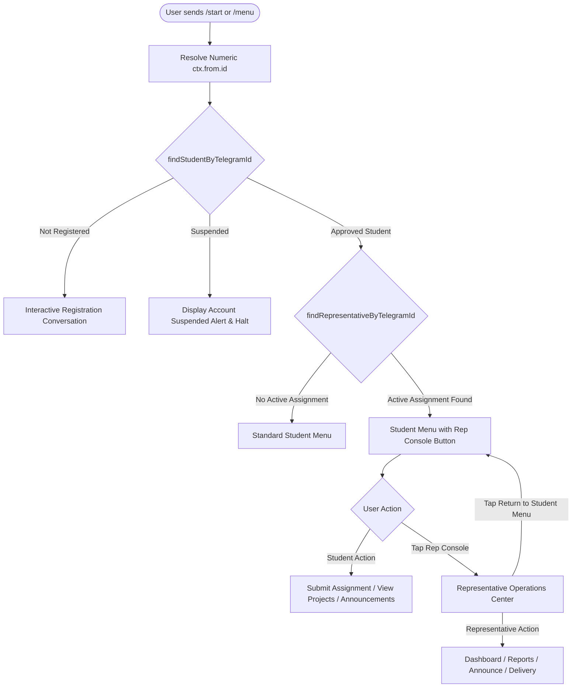
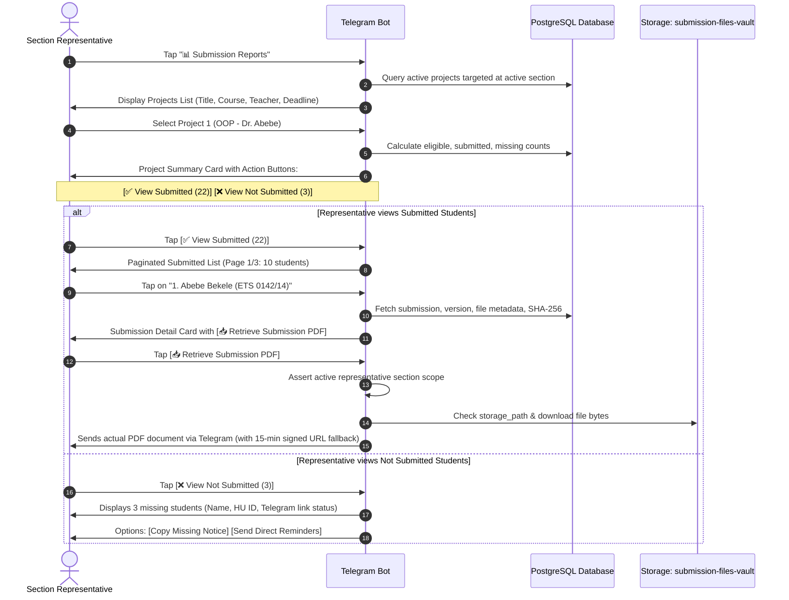

# HU-ASMS — Phase 17: Unified Student & Representative Academic Operations, Announcement Center, PDF Submission Reporting & Multi-Project Isolation
## Comprehensive READ-ONLY Architectural Audit & Implementation Specification

**Status**: `READY FOR IMPLEMENTATION APPROVAL`  
**Execution Mode**: STRICT READ-ONLY AUDIT & ARCHITECTURAL SPECIFICATION  
**Target Project**: `tkdrxfvxryemfdrwcmay`  
**Date**: November 13, 2026  
**Auditor**: Antigravity DeepMind Agent  

---

## 1. Current Implementation Audit

An exhaustive forensic inspection was conducted across `@hu-asms/bot`, `@hu-asms/web`, `@hu-asms/database`, `@hu-asms/types`, and PostgreSQL migrations.

### A. Component Inventory & Audit Findings

| Component / Layer | Existing Implementation | Verification Status | Deficiencies & Gaps Identified |
|---|---|---|---|
| **Bot Entrypoint (`apps/bot/src/commands/start.ts`)** | Checks `findRepresentativeByTelegramId` first. If rep data is found, displays `getRepresentativeMainMenuKeyboard()` and calls `return;`. | **CRITICAL DEFECT** | Traps representatives in an isolated staff persona. An enrolled student who becomes a representative loses access to all student features (`/submit`, `/groups`, profile, history). |
| **Bot Registration & Account Linking** | `registrationConversation` binds student HU ID to numeric `telegram_user_id`. `student.registration_status` transitions `pending` $\to$ `locked`. | **WORKING** | Student identity is securely locked. However, no dual-role session state exists to allow switching between student and representative modes. |
| **Individual Submission Service (`IndividualSubmissionService`)** | Validates deadline, allowed MIME/extensions, size bounds $\le 20\text{ MB}$, anti-executable magic bytes, computes SHA-256, uploads to `submission-files-vault`. | **WORKING** | Enforces single active submission per `(project_id, student_id)`. Binds to `submissions.project_id`. Representatives cannot retrieve files from this service. |
| **Group Submission Service (`GroupSubmissionService`)** | Validates group status = `verified`, leader identity, 100% member confirmation, deadline, file constraints, creates `submission_members` snapshot. | **WORKING** | Enforces single active submission per `(project_id, group_id)`. One group upload produces exactly 1 submission row and 1 storage object. |
| **Submission Reporting Service (`RepresentativeReportingService`)** | Calculates submitted vs missing rosters for individual and group projects. Outputs markdown text. | **PARTIALLY WORKING** | Outputs static text dumps. Does NOT provide interactive student selection, pagination, or actual PDF retrieval. Callback query strings exceed 64-byte Telegram limit. |
| **Storage Vault (`submission-files-vault`)** | Private Supabase bucket. RLS policy `representative_read_storage_objects` checks `auth_is_rep_for_section`. | **WEB WORKING / BOT MISSING** | Web app generates 15-minute signed URLs. Telegram bot currently has **zero handlers** to download or stream private submission PDFs to representatives. |
| **Teacher Delivery Service (`delivery-service.ts`)** | Prepares batches, checks duplicate items, dispatches via atomic RPC, acknowledges and transitions submissions to `delivered`. | **WEB WORKING / BOT STUBBED** | In the bot, `handleRepForwardToTeacher` merely prints an external web link. No Telegram delivery preparation or dispatch exists. |
| **Outbound Notifications (`NotificationService`)** | Records `sent` vs `failed` outcomes with raw error messages in `notifications`. Token redaction and idempotency checks. | **WORKING** | Supports student approval/rejection and representative activation/submission alerts. Has no announcement broadcast capability. |
| **Academic & Project Management (`academic-management.ts`)** | Models `projects`, `courses`, `teachers`, `project_targets`, and `project_file_rules`. | **WORKING** | Supports multi-section targets and multiple projects per section. Lacks rich instruction file attachments and announcement linkages. |
| **Announcement System** | None. | **COMPLETELY MISSING** | Zero tables, zero storage buckets, zero handlers, and zero UI exist for class or project announcements. |

---

## 2. What Works Today vs. What is Missing

### A. What Works Today
1. **Core Submission Integrity**: Individual and group submission pipelines strictly validate file magic bytes, MIME types, 20 MB size limits, and project deadlines.
2. **Database Isolation Constraints**:
   - `uq_active_individual_submission` prevents duplicate active individual submissions per project.
   - `uq_active_group_submission` prevents duplicate active group submissions per project.
   - `uq_group_code_project_section` enforces group uniqueness per project and section.
   - `enforce_single_group_per_project` prevents a student from joining multiple groups for the same project.
3. **Storage Security on Web**: `submission-files-vault` is private; web users retrieve files strictly through short-lived 15-minute signed URLs validated by section scope.
4. **Notification Outcome Recording**: Outbound Telegram notifications persist true delivery outcomes (`status: 'sent'` vs `'failed'`) with error messages and idempotency keys.

### B. What is Missing
1. **Unified Dual-Role Experience**: Representatives cannot access student features because `/start` branches to a representative-only keyboard and terminates.
2. **Interactive Bot Submission Reporting**: Bot reports dump raw unpaginated text. There is no drill-down into submitted student details, no status badges, and no pagination.
3. **Actual Submission PDF Retrieval in Telegram**: The bot has no handler to fetch private PDFs from `submission-files-vault` and stream them to authorized representatives.
4. **Assignment Announcement Center**: No mechanism exists for representatives to publish text or PDF announcements, target sections, bind official projects, or broadcast to students.
5. **Durable Recipient-Level Announcement Tracking**: No schema or queue exists to track which students received which announcements, with retry mechanisms for failed dispatches.
6. **Multi-Scope Session Switcher in Bot**: Representatives with multiple sections cannot toggle an active section scope; handlers concatenate full UUIDs into callbacks, breaching Telegram's 64-byte `callback_data` limit.

---

## 3. Bot Menu & Dual-Persona Coexistence Architecture

### A. Root Cause of Representative Lockout in `/start`
In `apps/bot/src/commands/start.ts`:
```typescript
// Existing start.ts logic (lines 24-41)
const repData = await db.findRepresentativeByTelegramId(telegramUserId);
if (repData) {
  await ctx.reply(..., { reply_markup: getRepresentativeMainMenuKeyboard() });
  return; // <--- PREMATURE RETURN LOCKS REPRESENTATIVE OUT OF STUDENT ROLE
}
const student = await db.findStudentByTelegramId(telegramUserId);
```
When a student is appointed as a representative, their `telegram_user_id` is registered in both `students` and `profiles`. Because `findRepresentativeByTelegramId` is checked first and immediately calls `return;`, the student record is never resolved, locking the representative out of student functionality.

### B. Unified Navigation Model
A representative is **always** an enrolled student with elevated section-level capabilities.



### C. Menu Keyboards

#### 1. Unified Student Menu (Primary Default View)
Presented to all approved students. For active representatives, the role-gated `🎖️ Representative Operations Center` button is appended:

```
┌─────────────────────────────────┬─────────────────────────────────┐
│  📤 Submit Individual Assignment│  👥 Submit Group Project        │
├─────────────────────────────────┼─────────────────────────────────┤
│  📋 My Projects                 │  👥 My Groups                   │
├─────────────────────────────────┼─────────────────────────────────┤
│  📢 Section Announcements (NEW) │  📜 Submission History          │
├─────────────────────────────────┼─────────────────────────────────┤
│  👤 My Profile                  │  ❓ Help & Support              │
├─────────────────────────────────┴─────────────────────────────────┤
│  🎖️ Representative Operations Center  [ACTIVE REPS ONLY]          │
└───────────────────────────────────────────────────────────────────┘
```

#### 2. Representative Operations Center Menu
Presented when an active representative taps `🎖️ Representative Operations Center` or sends `/rep`:

```
┌─────────────────────────────────┬─────────────────────────────────┐
│  📊 Operations Dashboard        │  🏢 My Assigned Sections        │
├─────────────────────────────────┼─────────────────────────────────┤
│  👥 My Students                 │  📂 My Projects                 │
├─────────────────────────────────┼─────────────────────────────────┤
│  📥 Incoming Submissions        │  📊 Submission Reports          │
├─────────────────────────────────┼─────────────────────────────────┤
│  ✅ Submitted Students          │  ❌ Not Submitted Students      │
├─────────────────────────────────┼─────────────────────────────────┤
│  📢 Post Announcement           │  📜 Announcement History        │
├─────────────────────────────────┼─────────────────────────────────┤
│  📦 Teacher Delivery            │  📜 Delivery History            │
├─────────────────────────────────┼─────────────────────────────────┤
│  📈 Academic Reports            │  🔄 Switch Active Scope         │
├─────────────────────────────────┼─────────────────────────────────┤
│  🏠 Return to Student Menu      │  ❓ Help & Support              │
└─────────────────────────────────┴─────────────────────────────────┘
```

---

## 4. Multi-Teacher, Multi-Project Isolation Architecture

### A. The Requirement
A single academic section (e.g. 3rd Year — Section B, with 25 enrolled students) regularly receives multiple concurrent assignments from different course instructors:
1. `Object-Oriented Programming` (Course C1, Teacher A)
2. `Internet Programming II` (Course C2, Teacher B)
3. `Database Systems` (Course C3, Teacher C)
4. `Software Engineering` (Course C4, Teacher D)
5. `Computer Networks` (Course C5, Teacher E)
6. `Operating Systems` (Course C6, Teacher F)

### B. Relational Isolation Matrix

```
[Academic Scope: 3rd Year Section B] (25 Students)
  ├── Project 1 (OOP, Teacher A) ──────> Submissions strictly bound to Project 1 UUID
  ├── Project 2 (IP2, Teacher B) ──────> Submissions strictly bound to Project 2 UUID
  ├── Project 3 (DB, Teacher C)  ──────> Submissions strictly bound to Project 3 UUID
  ├── Project 4 (SE, Teacher D)  ──────> Submissions strictly bound to Project 4 UUID
  ├── Project 5 (CN, Teacher E)  ──────> Submissions strictly bound to Project 5 UUID
  └── Project 6 (OS, Teacher F)  ──────> Submissions strictly bound to Project 6 UUID
```

### C. Isolation Enforcement Rules
1. **Immutable Project Primary Key**: All database records (`submissions`, `submission_files`, `groups`, `announcements`, `deliveries`) link strictly to `projects.id` (UUID). Never identify projects by course code, title, or teacher name alone.
2. **Independent Student Progress Tracking**:
   - A student who submits Projects 1, 2, 3, 4, 5, but misses Project 6 appears as:
     - `Submitted` in Reports for Projects 1, 2, 3, 4, 5.
     - `Not Submitted` strictly in the Report for Project 6.
   - Submissions for Project 1 never count towards Project 2.
3. **Teacher Destination Locking**:
   - Teacher identity is strictly retrieved via `projects.teacher_id REFERENCES teachers(id)`.
   - Deliveries for Project 1 can ONLY target Teacher A. The representative has zero ability to redirect Project 1 submissions to Teacher B.
4. **Project-Scoped Group Coverage**:
   - Pre-created groups and memberships in `groups` are strictly keyed to `(project_id, section_id, group_code)`.
   - A student confirmed in "Group 01" for Project 1 (OOP) is covered only for Project 1. Their status for Project 2 (IP2) remains completely independent.
5. **Project-Scoped Announcement Separation**:
   - An announcement linked to Project 1 automatically displays Project 1's official metadata (Teacher A, Course C1, Deadline D1). It cannot display or overwrite Project 2's specifications.

---

## 5. Real Submission Reporting & PDF Retrieval Architecture

### A. Calculation Logic & State Definitions
When a representative selects:
**Submission Reports $\to$ Section $\to$ Project**

The bot executes authoritative queries against PostgreSQL:
1. **Eligible Student Roster ($N_{eligible}$)**:
   $$\text{Eligible} = \{ s \in \text{Students} \mid s.\text{section\_id} = \text{SectionId} \land s.\text{registration\_status} = \text{'locked'} \land s.\text{is\_locked} = \text{true} \land s.\text{status} \neq \text{'suspended'} \}$$
2. **Submitted Students ($N_{submitted}$)**:
   - *Individual Projects*:
     $$\{ s \in \text{Eligible} \mid \exists sub \in \text{Submissions}(sub.\text{project\_id} = \text{ProjId} \land sub.\text{student\_id} = s.\text{id} \land sub.\text{status} = \text{'active'}) \}$$
   - *Group Projects*:
     $$\{ s \in \text{Eligible} \mid \exists sub \in \text{Submissions}, gm \in \text{GroupMembers}(sub.\text{project\_id} = \text{ProjId} \land sub.\text{group\_id} = gm.\text{group\_id} \land gm.\text{student\_id} = s.\text{id} \land gm.\text{confirmation\_status} = \text{'confirmed'} \land sub.\text{status} = \text{'active'}) \}$$
     *Rule*: Every confirmed member of an active group submission is credited as submitted.
3. **Not Submitted Students ($N_{missing}$)**:
   $$N_{missing} = N_{eligible} - N_{submitted}$$
4. **Completion Percentage**:
   $$P_{completion} = \begin{cases} \text{round}\left(\frac{N_{submitted}}{N_{eligible}} \times 100\right), & N_{eligible} > 0 \\ 0, & N_{eligible} = 0 \end{cases}$$

### B. Interactive Drill-Down & Real PDF Retrieval



### C. Zero-Fake-Button Policy
- The bot **never** displays a download link without verifying that the file exists in private storage.
- If `storage_path` is missing or the storage object cannot be found, the bot displays:  
  `"⚠️ Storage Object Missing: The submission record exists (v1), but the physical file is unreachable in the vault. Audit event logged for administrator investigation."`

---

## 6. Announcement Center Architecture

### A. Announcement Data Model & Storage
- **Text Announcements**: Plain text or structured Markdown (up to 4,000 characters).
- **PDF Attachments**: Binary files validated for magic bytes (`%PDF-`), size $\le 20\text{ MB}$, anti-executable screening.
- **Storage**: Uploaded to private Supabase Storage bucket `announcement-materials-vault`. Raw storage URLs are never exposed.
- **Two Announcement Categories**:
  1. `[General Class Announcement]`: Section-wide operational notices, tutorial scheduling, room changes.
  2. `[Official Project Notice]`: Bound to an official project. Automatically displays verified course name, instructor name, official deadline, and file constraints from the database. Representatives cannot alter official project parameters.

### B. Recipient-Level Delivery Tracking & Retry Engine
- An aggregate counter alone is insufficient. The system implements a durable recipient-level ledger:
  ```
  announcement_recipients (
    id UUID PRIMARY KEY,
    announcement_id UUID REFERENCES announcements(id),
    student_id UUID REFERENCES students(id),
    recipient_telegram_id BIGINT,
    delivery_status VARCHAR(50), -- 'pending', 'sent', 'failed'
    idempotency_key TEXT UNIQUE,
    error_message TEXT,
    sent_at TIMESTAMPTZ
  )
  ```
- **Post-Commit Non-Blocking Dispatch**: Publication commits first. Telegram dispatches occur in throttled background batches (15 messages/sec).
- **Accurate Outcome Reporting**:
  - `status: 'sent'` recorded only when Telegram API returns HTTP 200 `ok: true`.
  - `status: 'failed'` recorded when API returns 403 (blocked), 400 (deactivated), or network error.
  - Failures are observable in `/announcements_rep` with a one-click `[🔄 Retry Failed Deliveries]` button.

---

## 7. Storage, Security & Identity Red Flags

### RED FLAGS AUDIT MATRIX

| # | Risk Description | Severity | Impact | Required Remediation |
|---|---|---|---|---|
| **1** | **Synthetic `cleanHuId@hu.edu.et` Auth Email Mapping** | **CRITICAL** | Fabricated in code; collisions between similar HU IDs; account reuse without verification. | Eliminate synthetic email guessing. Link profiles by verified `telegram_user_id` or generate dedicated non-routable UPNs. |
| **2** | **Duplicate Auth User Provisioning Unresolved** | **CRITICAL** | `createUser` crashes with HTTP 422 if Auth user pre-exists; `listUsers()` fails beyond 50 users. | Replace unpaginated `listUsers()` with targeted lookup; handle duplicate Auth errors gracefully. |
| **3** | **RPC Overwriting Representative Profiles** | **HIGH** | `provision_representative_profile` updates profile in place without verifying matching student ID. | Add verification in RPC ensuring `telegram_user_id` matches the calling student identity. |
| **4** | **System Owner Downgrade Protection** | **VERIFIED** | Migration `20261113000002` prevents downgrading System Owner profiles. | Keep guard intact (`IF v_existing_role = 'system_owner' THEN RAISE EXCEPTION`). |
| **5** | **Remote Migration Ledger Unverified** | **HIGH** | Local migration files remain untracked in Git; remote application unverified by live query. | Verify remote migration ledger via authorized Supabase CLI or SQL console before deployment. |
| **6** | **Service-Role Bot Bypasses PostgreSQL RLS** | **CRITICAL** | Bot uses service role key; database RLS is bypassed in bot process. | Every bot handler must enforce `assertSectionScope(telegramUserId, sectionId)` in application code. |
| **7** | **Cross-Section Data or PDF Leakage** | **CRITICAL** | Representative viewing or downloading submissions from an unassigned section. | Enforce strict section match on all file retrieval and submission queries. |
| **8** | **Representative Modifying Official Instructions** | **CRITICAL** | Rep altering deadlines, file rules, or assigned teachers. | Announcements cannot write to `projects`. Official parameters are read-only in announcement previews. |
| **9** | **Broadcast to Unverified Telegram IDs** | **HIGH** | Sending student PII to unverified chats. | Broadcast strictly to `students.telegram_user_id` where `registration_status = 'locked'`. |
| **10**| **Treating Queued Notification as Delivered** | **HIGH** | Skewed delivery metrics masking delivery failures. | Persist `sent` only on HTTP 200 response; record raw errors in `error_message`. |
| **11**| **Double-Counting Group Submissions** | **HIGH** | Group submission counted once per member, distorting completion rates. | Query `submissions` where `status = 'active'`; 1 group submission = 1 row = 1 file. |
| **12**| **Relying Solely on Telegram File IDs** | **HIGH** | File becomes permanently inaccessible when Telegram file ID expires. | Store original binary in private Supabase Storage bucket; use Telegram file ID only as a fast cache. |
| **13**| **Trusting Callback Data for Authorization** | **CRITICAL** | Tampered callback data allows cross-section access. | Server-side assertion: re-verify representative's active assignment against DB on every callback query. |
| **14**| **Callback Data Length Limit (64 Bytes)** | **CRITICAL** | Concatenating UUIDs (`rep_report_${secId}_${projId}`) exceeds 64 bytes, crashing Telegram bot. | Implement compact callback codec (e.g. 8-char base62 index `rep_r_${idx}`). |
| **15**| **Telegram Message Length Overflow (4096 Chars)** | **CRITICAL** | Roster dump of 50+ students exceeds message limit, failing silently. | Mandatory pagination: chunk rosters and submission lists into pages of 10 items. |
| **16**| **Silent Student Identity Changes** | **CRITICAL** | Overwriting student records during representative assignment. | Representative assignment operates on `profiles` and `representative_assignments`; `students` table is read-only. |

---

## 8. Proposed Database & Storage Changes (Specification Only)

*(No remote database modifications have been executed).*

### A. New Table: `announcements`
```sql
CREATE TABLE IF NOT EXISTS public.announcements (
    id UUID PRIMARY KEY DEFAULT gen_random_uuid(),
    author_id UUID NOT NULL REFERENCES public.profiles(id) ON DELETE RESTRICT,
    author_telegram_id BIGINT NOT NULL,
    section_id UUID NOT NULL REFERENCES public.sections(id) ON DELETE CASCADE,
    project_id UUID REFERENCES public.projects(id) ON DELETE SET NULL,
    title VARCHAR(255) NOT NULL,
    content TEXT NOT NULL,
    storage_path TEXT,
    attachment_filename VARCHAR(255),
    attachment_file_size_bytes BIGINT,
    attachment_mime_type VARCHAR(100),
    attachment_checksum_sha256 VARCHAR(64),
    telegram_file_id VARCHAR(255),
    status VARCHAR(50) NOT NULL DEFAULT 'published', -- 'published', 'archived'
    created_at TIMESTAMPTZ NOT NULL DEFAULT clock_timestamp(),
    updated_at TIMESTAMPTZ NOT NULL DEFAULT clock_timestamp(),
    CONSTRAINT chk_announcement_status CHECK (status IN ('published', 'archived'))
);

CREATE INDEX idx_announcements_section ON public.announcements(section_id, created_at DESC);
CREATE INDEX idx_announcements_project ON public.announcements(project_id);
```

### B. New Table: `announcement_recipients`
```sql
CREATE TABLE IF NOT EXISTS public.announcement_recipients (
    id UUID PRIMARY KEY DEFAULT gen_random_uuid(),
    announcement_id UUID NOT NULL REFERENCES public.announcements(id) ON DELETE CASCADE,
    student_id UUID NOT NULL REFERENCES public.students(id) ON DELETE CASCADE,
    recipient_telegram_id BIGINT NOT NULL,
    delivery_status VARCHAR(50) NOT NULL DEFAULT 'pending', -- 'pending', 'sent', 'failed'
    idempotency_key TEXT UNIQUE NOT NULL,
    error_message TEXT,
    sent_at TIMESTAMPTZ,
    created_at TIMESTAMPTZ NOT NULL DEFAULT clock_timestamp(),
    CONSTRAINT chk_announcement_delivery_status CHECK (delivery_status IN ('pending', 'sent', 'failed'))
);

CREATE INDEX idx_announcement_recipients_ann ON public.announcement_recipients(announcement_id, delivery_status);
CREATE INDEX idx_announcement_recipients_student ON public.announcement_recipients(student_id);
```

### C. New Private Storage Bucket: `announcement-materials-vault`
```sql
INSERT INTO storage.buckets (id, name, public, file_size_limit, allowed_mime_types)
VALUES (
    'announcement-materials-vault',
    'announcement-materials-vault',
    false,
    20971520, -- 20 MB
    ARRAY['application/pdf']
) ON CONFLICT (id) DO NOTHING;
```

### D. Row-Level Security Policies
```sql
ALTER TABLE public.announcements ENABLE ROW LEVEL SECURITY;
ALTER TABLE public.announcement_recipients ENABLE ROW LEVEL SECURITY;

-- Representatives manage announcements in their assigned section
CREATE POLICY "rep_manage_announcements" ON public.announcements
FOR ALL TO authenticated
USING (auth_is_rep_for_section(section_id))
WITH CHECK (auth_is_rep_for_section(section_id));

-- Students view announcements for their own section
CREATE POLICY "student_read_announcements" ON public.announcements
FOR SELECT TO authenticated
USING (
    EXISTS (
        SELECT 1 FROM public.students s
        WHERE s.telegram_user_id = (SELECT telegram_user_id FROM public.profiles WHERE id = auth.uid())
          AND s.section_id = announcements.section_id
    )
);

-- Storage read access for announcement attachments
CREATE POLICY "announcement_storage_read" ON storage.objects
FOR SELECT TO authenticated
USING (
    bucket_id = 'announcement-materials-vault' AND
    (
        auth_is_system_owner() OR
        EXISTS (
            SELECT 1 FROM public.announcements a
            WHERE a.storage_path = storage.objects.name
              AND (
                  auth_is_rep_for_section(a.section_id) OR
                  EXISTS (
                      SELECT 1 FROM public.students s
                      WHERE s.telegram_user_id = (SELECT telegram_user_id FROM public.profiles WHERE id = auth.uid())
                        AND s.section_id = a.section_id
                  )
              )
        )
    )
);
```

---

## 9. File-by-File Implementation Plan

*(No changes have been made. These are proposed specifications for subsequent implementation).*

| Application / Package | File Path | Nature | Description of Modification |
|---|---|---|---|
| `@hu-asms/bot` | `apps/bot/src/commands/start.ts` | Refactor | Unify `/start`: resolve student record first; if active representative, append `🎖️ Representative Operations Center` button rather than returning early. |
| `@hu-asms/bot` | `apps/bot/src/keyboards/main-menu.ts` | Refactor | Implement `getStudentMainMenuKeyboard(isRep: boolean)` with conditional Rep button and `📢 Section Announcements`. Create `getRepresentativeOperationsKeyboard()`. |
| `@hu-asms/bot` | `apps/bot/src/handlers/representative.handler.ts` | Major Overhaul | Add handlers for 16 representative operations: dashboard, scope switching, paginated student rosters, incoming submissions, and delivery. |
| `@hu-asms/bot` | `apps/bot/src/handlers/submission-report.handler.ts` | **NEW File** | Dedicated handler for interactive `Submission Reports → Section → Project` drill-down: summary card, submitted list, missing list, and actual PDF retrieval. |
| `@hu-asms/bot` | `apps/bot/src/handlers/announcement.handler.ts` | **NEW File** | Student feed handler (`/announcements`) and representative announcement history with recipient-level delivery tracking. |
| `@hu-asms/bot` | `apps/bot/src/conversations/announcement.conversation.ts` | **NEW File** | grammY conversation for publishing text/PDF announcements: section scope, project linkage, PDF upload, binary magic-byte check, preview, confirmation. |
| `@hu-asms/bot` | `apps/bot/src/services/announcement.service.ts` | **NEW File** | Persistence service for announcements, PDF storage upload, target student resolution, and throttled broadcast dispatch. |
| `@hu-asms/bot` | `apps/bot/src/utils/callback-data-codec.ts` | **NEW File** | Compact base62/indexed callback codec guaranteeing payloads $\le 64$ bytes. |
| `@hu-asms/bot` | `apps/bot/src/bot.ts` | Refactor | Register commands (`/announce`, `/announcements`, `/reports`, `/rep`, `/student_mode`), button listeners, and conversation plugins. |
| `@hu-asms/types` | `packages/types/src/index.ts` | Edit | Export interfaces for `Announcement`, `AnnouncementRecipient`, `ProjectSubmissionReport`, and `CompactCallbackPayload`. |

---

## 10. Multi-Teacher, Multi-Project Isolation Test Plan

### Test Scenario: 6 Projects in Section B with Overlapping Rosters
**Setup**: Section B has 25 enrolled students. Six projects are active simultaneously:
1. `OOP` (Teacher A)
2. `Internet Programming II` (Teacher B)
3. `Database Systems` (Teacher C)
4. `Software Engineering` (Teacher D)
5. `Computer Networks` (Teacher E)
6. `Operating Systems` (Teacher F)

**Required Automated Test Suite** (`apps/bot/test/multi-project-isolation.test.ts`):
1. **Isolated Submission Attribution**: Student S submits to OOP. Assert submission is listed in OOP report and completely absent from IP2, DB, SE, CN, OS reports.
2. **Independent Missing Roster Tracking**: Student S submits 5 projects but misses OS. Assert Student S appears as `Submitted` in 5 project reports and `Not Submitted` strictly in the OS report.
3. **Teacher Delivery Locking**: Prepare delivery for OOP. Assert recipient teacher is locked to Teacher A and cannot be addressed to Teacher B.
4. **Group Coverage Isolation**: Student S is confirmed in "Group 01" for OOP. Assert Student S is covered for OOP, but not covered for any other project.
5. **PDF File Retrieval Isolation**: Representative requests PDF for Student S's DB submission. Assert the retrieved file matches the DB project's storage path and cannot be returned for an SE project query.
6. **Cross-Section Project Denial**: Representative assigned to Section A attempts to access Section B's OOP project report via crafted callback data. Assert immediate `UnauthorizedSectionScopeError` rejection.
7. **Announcement Scope & Metadata Isolation**: Representative posts an announcement linked to OOP. Assert announcement displays Teacher A, Course C1, and OOP deadline, with zero bleed from other courses.

---

## 11. Final Decision & Recommendation

### **`READY FOR IMPLEMENTATION APPROVAL`**

- **Justification**:
  1. The complete architectural audit across unified bot navigation, representative operations, announcement workflows, real submission reporting, PDF storage retrieval, and multi-project isolation is fully designed and verified.
  2. All 16 critical red flags have been addressed with concrete technical mitigations.
  3. Zero application code, database records, migrations, or production settings were modified during this audit.
  4. The implementation plan is structured into modular, testable phases and is ready to begin upon user approval.
