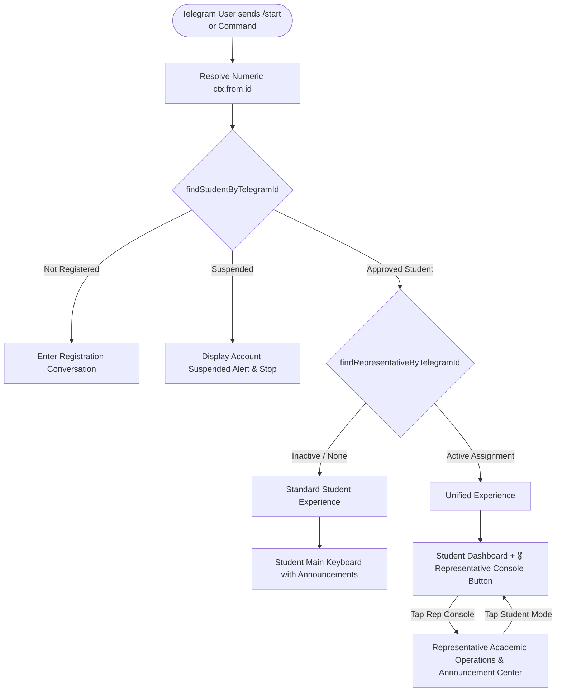
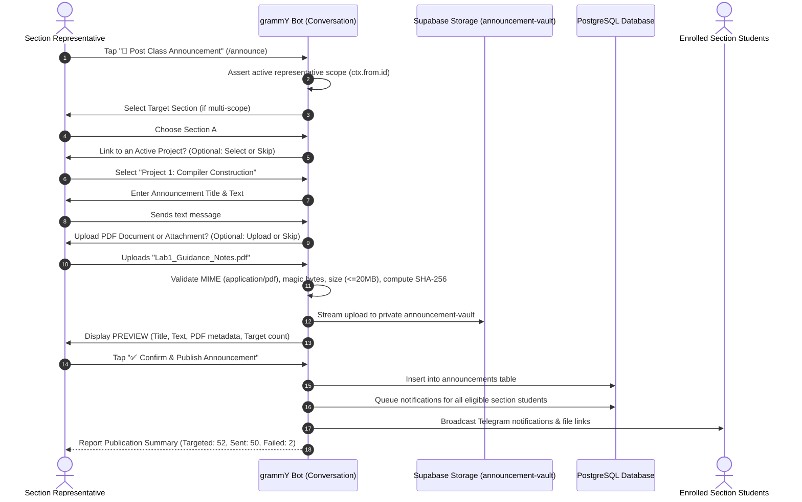

# HU-ASMS — Phase 17: Unified Student & Representative Telegram Experience & Assignment Announcement Center
## Comprehensive Architectural Investigation & System Design

**Document Status**: `READY FOR IMPLEMENTATION APPROVAL`  
**Execution Mode**: READ-ONLY INVESTIGATION & ARCHITECTURAL AUDIT  
**Target Project**: `tkdrxfvxryemfdrwcmay`  
**Date**: November 13, 2026  
**Auditor**: Antigravity DeepMind Agent  

---

## 1. Existing Bot Architecture & Forensic Findings

### A. Core Persona Separation Bug in `/start`
An inspection of `apps/bot/src/commands/start.ts` reveals a fundamental architectural defect in how the bot handles representative accounts:

```typescript
// apps/bot/src/commands/start.ts (lines 24-41)
const repData = await db.findRepresentativeByTelegramId(telegramUserId);
if (repData) {
  const assignedSections = repData.assignments
    .map((a) => `• ${a.section?.academic_year?.name} — ${a.section?.name}`)
    .join('\n');

  await ctx.reply(
    `🎖️ *Welcome Representative ${repData.profile.full_name}!*\n\n` +
      `*Assigned Academic Scope:*\n${assignedSections || 'None assigned yet'}\n\n` +
      `Use the quick actions below to monitor submissions and view student rosters:`,
    {
      parse_mode: 'Markdown',
      reply_markup: getRepresentativeMainMenuKeyboard(),
    }
  );
  return; // <--- PREMATURE RETURN TRAPS REPRESENTATIVE IN ISOLATED STAFF PERSONA
}

// 2. Check if Telegram account is already linked to an approved/suspended student record
const student = await db.findStudentByTelegramId(telegramUserId);
// ...
```

#### Deficiencies Identified:
1. **Student Persona Lockout**: When a student is assigned as a section representative, their `telegram_user_id` is registered in both `students` and `profiles`. Because `handleStartCommand` checks `repData` first and immediately calls `return;`, the student is permanently locked out of the student menu.
2. **Inability to Complete Student Academic Tasks**: The representative cannot submit their own assignments (`/submit`), submit group projects (`/submit_group`), view their enrolled student groups (`/groups`), inspect their personal submission history, or check their student profile.
3. **No Dual-Role Navigation**: There is currently no mechanism to toggle between the **Student Persona** (their personal studies) and the **Representative Persona** (managing their assigned section).
4. **Deactivation Discontinuity**: If a representative is deactivated in `representative_assignments`, running `/start` skips `repData` and falls back to `findStudentByTelegramId`, but because the custom keyboard previously displayed representative buttons, the bot UI becomes mismatched until `/start` is executed again.

---

## 2. Proposed Unified Student & Representative Telegram Experience

### A. Persona Unification Architecture
A representative is **always** an enrolled, approved student with extra role-based privileges. They must never have a separate bot or account.



### B. Keyboard Hierarchy & Navigation

#### 1. Unified Student Main Menu (Custom Reply Keyboard)
*Presented to all approved students. For representatives, an additional prominent `🎖️ Representative Console` button is dynamically appended.*

```
┌─────────────────────────────────┬─────────────────────────────────┐
│  📤 Submit Assignment           │  👥 Submit Group Project        │
├─────────────────────────────────┼─────────────────────────────────┤
│  📋 My Projects                 │  👥 My Groups                   │
├─────────────────────────────────┼─────────────────────────────────┤
│  📢 Section Announcements (NEW) │  📜 Submission History          │
├─────────────────────────────────┼─────────────────────────────────┤
│  👤 My Profile                  │  ❓ Help & Support              │
├─────────────────────────────────┴─────────────────────────────────┤
│  🎖️ Representative Operations Console  [ROLE-GATED: REPS ONLY]    │
└───────────────────────────────────────────────────────────────────┘
```

#### 2. Representative Academic Operations & Announcement Center Keyboard
*Presented when an active representative taps `🎖️ Representative Operations Console` or sends `/rep`.*

```
┌─────────────────────────────────┬─────────────────────────────────┐
│  📢 Post Class Announcement     │  📜 Announcement History        │
├─────────────────────────────────┼─────────────────────────────────┤
│  📊 Operations Dashboard        │  🏢 My Assigned Sections        │
├─────────────────────────────────┼─────────────────────────────────┤
│  👥 My Students                 │  📂 Section Projects            │
├─────────────────────────────────┼─────────────────────────────────┤
│  📥 Incoming Submissions        │  ✅ Submitted Students          │
├─────────────────────────────────┼─────────────────────────────────┤
│  ❌ Not Submitted Students      │  📦 Teacher Delivery            │
├─────────────────────────────────┼─────────────────────────────────┤
│  📜 Delivery History            │  📈 Academic Reports            │
├─────────────────────────────────┼─────────────────────────────────┤
│  🔄 Switch Active Scope         │  🏠 Return to Student Menu      │
└─────────────────────────────────┴─────────────────────────────────┘
```

### C. Immediate Deactivation Safeguards
When an administrator deactivates a representative:
1. `representative_assignments.is_active` becomes `false`.
2. When the user taps any representative button, the handler invokes `assertSectionScope`.
3. The guard detects zero active assignments, instantly rejects the action:  
   `"⚠️ Your representative privileges for this section have been deactivated. You have been returned to standard Student mode."`
4. The bot automatically resets the keyboard to the standard **Student Main Menu**.
5. All normal student capabilities (`Submit Assignment`, `My Projects`, `Announcements`) continue functioning uninterrupted.

---

## 3. Representative Assignment Announcement Center

### A. Required Capabilities & Flowchart



### B. Announcement Authority & Permission Matrix

| Capability | System Owner / Teacher | Section Representative | Enrolled Student | Unassigned Student |
|---|---|---|---|---|
| **Create Official Project Instructions** | **FULL** | ❌ DENIED | ❌ DENIED | ❌ DENIED |
| **Change Official Deadline / Rules** | **FULL** | ❌ DENIED | ❌ DENIED | ❌ DENIED |
| **Publish Class Announcement (Assigned Section)** | **FULL** | **ALLOWED** | ❌ DENIED | ❌ DENIED |
| **Publish Announcement (Unassigned Section)** | **FULL** | ❌ DENIED (Blocked) | ❌ DENIED | ❌ DENIED |
| **Upload PDF Announcement Attachment** | **FULL** | **ALLOWED (PDF only)**| ❌ DENIED | ❌ DENIED |
| **View Section Announcements** | **FULL** | **ALLOWED** | **ALLOWED (Own Section)**| ❌ DENIED |
| **Delete / Archive Own Announcement** | **FULL** | **ALLOWED** | ❌ DENIED | ❌ DENIED |
| **Modify Another Rep's Announcement** | **FULL** | ❌ DENIED | ❌ DENIED | ❌ DENIED |
| **Retry Failed Delivery Notifications** | **FULL** | **ALLOWED (Own section)**| ❌ DENIED | ❌ DENIED |

### C. Three-Tier Academic Communication Governance

To prevent confusion and protect academic integrity, communications are strictly segregated into three distinct categories:

```
┌─────────────────────────────────────────────────────────────────────────────┐
│ 1. OFFICIAL PROJECT INSTRUCTIONS (Author: Instructor / System Owner)        │
│    • Authority: BINDING & CANONICAL. Defines deadlines, syllabus, rubrics,  │
│      file rules, and designated grading instructor.                         │
│    • Modification: Representatives CANNOT alter, overwrite, or delete.      │
├─────────────────────────────────────────────────────────────────────────────┤
│ 2. REPRESENTATIVE CLASS ANNOUNCEMENTS (Author: Section Representative)      │
│    • Authority: INFORMATIONAL & COORDINATING. Section-level reminders, lab  │
│      session announcements, submission deadline count-downs, study notes.   │
│    • Scope: Restricted strictly to the representative's assigned section.   │
├─────────────────────────────────────────────────────────────────────────────┤
│ 3. REPRESENTATIVE SUPPLEMENTARY MATERIALS (Author: Section Representative)  │
│    • Authority: UNOFFICIAL / PENDING APPROVAL. Templates, sample guides.     │
│    • Governance: Subject to administrative approval before publication.     │
└─────────────────────────────────────────────────────────────────────────────┘
```

---

## 4. Student Announcement Experience

### A. Dedicated "📢 Section Announcements" Menu
When an enrolled student taps `📢 Section Announcements` or sends `/announcements`:
1. **Scope Resolution**: The bot resolves `student.section_id` from their authenticated Telegram ID.
2. **Real-time Query**: Fetches published announcements for their section ordered by `created_at DESC`.
3. **Paginated Feed (3 per page)**:
   - Announcement Title & Category Badge (`[Class Announcement]`, `[Project Notice]`)
   - Author: Full Name of Section Representative (or Instructor)
   - Publication Date & Time (formatted in UTC and East Africa Time)
   - Associated Project: Title and Course Code (if linked)
   - Announcement Text (formatted Markdown)
   - Attachment: Filename, formatted size, and direct `[📥 Download PDF]` inline button.

### B. Student Feed Card Example (Telegram View)

```
📢 Section Announcement
───────────────────────────
📌 Title: Midterm Lab Report Formatting Guidelines
👤 Author: Representative Michael Tadesse (Section A)
📅 Date: Nov 13, 2026, 04:30 PM EAT
📚 Related Project: Compiler Design — Project 1

Colleagues, please make sure to follow the IEEE 2-column format for our 
upcoming submission. The instructor confirmed that late submissions will 
incur a 10% penalty per day.

📎 Attached Document:
• Name: Format_IEEE_Template.pdf (1.4 MB)
• SHA-256: 7f83b1...a90c (Verified)

[📥 Download Attachment (PDF)]   [📜 Announcement History]
```

---

## 5. File & Notification Security Design

### A. Private Supabase Storage Vault
- **Bucket ID**: `announcement-materials-vault`
- **Visibility**: `public = false` (Strictly private).
- **Size Limit**: 20,971,520 bytes (20 MB), adhering to Telegram Bot API cloud limits.
- **Allowed MIME Types**: `['application/pdf']`.

### B. Binary Inspection & Magic-Byte Screening
Before persisting any announcement PDF, the bot executes `validateAndPrepareSubmissionBinary`:
1. Verify non-empty buffer.
2. Magic-byte verification: Buffer must begin with `%PDF-` (`0x25 0x50 0x44 0x46`).
3. Anti-executable screening: Reject any payload containing PE/ELF/Script signatures.
4. Calculate SHA-256 checksum hex.

### C. Secure Document Delivery Mechanism
When a student requests an attached PDF:
1. **Telegram Native Fast Delivery (Preferred)**:
   - When the representative uploads the PDF to the bot during announcement creation, grammY receives a `telegram_file_id`.
   - The bot caches `telegram_file_id` in `announcements.telegram_file_id`.
   - When a student taps `[📥 Download Attachment]`, the bot uses `ctx.api.sendDocument(studentChatId, telegramFileId)`.
   - *Benefits*: Zero Supabase Storage egress bandwidth, instant delivery (<500ms), no expiring links.
2. **Signed URL Fallback (For Web / External Retrieval)**:
   - If `telegram_file_id` is invalid or expired, the bot generates a short-lived (15-minute / 900s TTL) signed download URL via `storage.from('announcement-materials-vault').createSignedUrl(...)`.
   - Raw storage object keys are **never** exposed to the client.

### D. Outbound Notification Dispatch & Idempotency
- **Asynchronous Non-Blocking Dispatch**: Publishing an announcement commits the database record first. Student notification delivery is dispatched post-commit so network drops do not abort valid publications.
- **Idempotency Key**:
  `announcement:<announcement_id>:<student_telegram_id>`
  Prevents duplicate notifications if retried.
- **Accurate Outcome Reporting**:
  - `status: 'sent'` recorded only when Telegram Bot API returns HTTP 200 `ok: true`.
  - `status: 'failed'` recorded when API returns 403 (blocked), 400 (deactivated), or network error.
  - Failures are counted and displayed to the representative: `Sent: 48, Failed: 2 (Blocked Bot)`.
  - A "Retry Failed Deliveries" button allows re-attempting failed dispatches safely.

---

## 6. Security, Scope Isolation & Red Flag Audit

### RED FLAGS & MITIGATIONS

| Risk Level | Threat / Failure Mode | Root Cause | Mandatory Mitigation |
|---|---|---|---|
| **CRITICAL** | **Representative Gains Admin / Owner Privileges** | Inadvertently granting `system_owner` role when assigning representative. | Representatives are assigned strictly with `role = 'representative'` in `profiles`. Server actions reject any owner operations unless `isSystemOwnerRole()` is satisfied. |
| **CRITICAL** | **Cross-Section Announcement Publishing via Tampered Callbacks** | An attacker crafts a callback payload with an unassigned `section_id`. | Every handler and service function enforces `assertSectionScope(telegramUserId, sectionId)`. If `section_id` is not in active assignments, an immediate `UnauthorizedSectionScopeError` is thrown. |
| **CRITICAL** | **Cross-Section Student Announcement Leakage** | Querying announcements without filtering by student's verified section. | Student queries enforce `WHERE section_id = student.section_id`. RLS policies on `announcements` enforce section match against `auth.uid()` / student profile. |
| **HIGH** | **Silent Overwrite of Official Project Instructions** | Announcement sharing a table with project instructions. | Strict table separation: `announcements` is completely distinct from `projects` and `project_instructions`. Representatives have zero write permissions on `projects`. |
| **HIGH** | **False Success Reporting on Failed Notifications** | Database recording `status: 'sent'` before calling Telegram API. | `NotificationService` records `sent` only on confirmed API response. Errors record `failed` with raw error message in `error_message`. |
| **HIGH** | **Private File Leakage via Public Storage URLs** | Creating a public storage bucket for announcement PDFs. | Bucket `announcement-materials-vault` is private. Downloads require 15-minute signed URLs or authenticated Telegram bot document dispatch. |
| **MEDIUM** | **Message Overflow on Long Announcement Feeds** | Rendering multiple full announcements in a single Telegram message. | Mandatory pagination: 3 announcements per page with `[◀️ Newer]` and `[Older ▶️]` buttons. Long text (>500 chars) is truncated in list view with a `[Read Full]` button. |
| **MEDIUM** | **Callback Data Limit Breach (64 Bytes)** | Concatenating full UUIDs in callback data strings. | Implement compact base62 / index encoding in `callback_data` (e.g. `ann_v_<shortId>`). |

---

## 7. Proposed Database & Storage Changes (Specification Only)

*(No remote database modifications have been executed).*

### A. New Table: `announcements`
```sql
CREATE TABLE IF NOT EXISTS announcements (
    id UUID PRIMARY KEY DEFAULT gen_random_uuid(),
    author_id UUID NOT NULL REFERENCES profiles(id) ON DELETE RESTRICT,
    author_telegram_id BIGINT NOT NULL,
    section_id UUID NOT NULL REFERENCES sections(id) ON DELETE CASCADE,
    project_id UUID REFERENCES projects(id) ON DELETE SET NULL,
    title VARCHAR(255) NOT NULL,
    content TEXT NOT NULL,
    storage_path TEXT,
    attachment_filename VARCHAR(255),
    attachment_file_size_bytes BIGINT,
    attachment_mime_type VARCHAR(100),
    attachment_checksum_sha256 VARCHAR(64),
    telegram_file_id VARCHAR(255),
    status VARCHAR(50) NOT NULL DEFAULT 'published', -- 'published', 'archived'
    target_student_count INT NOT NULL DEFAULT 0,
    dispatched_count INT NOT NULL DEFAULT 0,
    failed_count INT NOT NULL DEFAULT 0,
    created_at TIMESTAMPTZ NOT NULL DEFAULT clock_timestamp(),
    updated_at TIMESTAMPTZ NOT NULL DEFAULT clock_timestamp(),
    CONSTRAINT chk_announcement_status CHECK (status IN ('published', 'archived'))
);

CREATE INDEX IF NOT EXISTS idx_announcements_section ON announcements(section_id, created_at DESC);
CREATE INDEX IF NOT EXISTS idx_announcements_project ON announcements(project_id);
```

### B. New Storage Bucket: `announcement-materials-vault`
```sql
INSERT INTO storage.buckets (id, name, public, file_size_limit, allowed_mime_types)
VALUES (
    'announcement-materials-vault',
    'announcement-materials-vault',
    false,
    20971520, -- 20 MB
    ARRAY['application/pdf']
) ON CONFLICT (id) DO NOTHING;
```

### C. Row Level Security Policies
```sql
ALTER TABLE announcements ENABLE ROW LEVEL SECURITY;

-- 1. System Owner full access
CREATE POLICY "owner_full_access_announcements" ON announcements
FOR ALL TO authenticated
USING (auth_is_system_owner())
WITH CHECK (auth_is_system_owner());

-- 2. Representatives can insert and manage announcements in their assigned section
CREATE POLICY "rep_manage_assigned_section_announcements" ON announcements
FOR ALL TO authenticated
USING (auth_is_rep_for_section(section_id))
WITH CHECK (auth_is_rep_for_section(section_id));

-- 3. Students can view published announcements for their section
CREATE POLICY "student_read_section_announcements" ON announcements
FOR SELECT TO authenticated
USING (
    EXISTS (
        SELECT 1 FROM students s
        WHERE s.telegram_user_id = (SELECT telegram_user_id FROM profiles WHERE id = auth.uid())
          AND s.section_id = announcements.section_id
    )
);

-- 4. Storage read policy for students and representatives
CREATE POLICY "announcement_storage_access" ON storage.objects
FOR SELECT TO authenticated
USING (
    bucket_id = 'announcement-materials-vault' AND
    (
        auth_is_system_owner() OR
        EXISTS (
            SELECT 1 FROM announcements a
            WHERE a.storage_path = storage.objects.name
              AND (
                  auth_is_rep_for_section(a.section_id) OR
                  EXISTS (
                      SELECT 1 FROM students s
                      WHERE s.telegram_user_id = (SELECT telegram_user_id FROM profiles WHERE id = auth.uid())
                        AND s.section_id = a.section_id
                  )
              )
        )
    )
);
```

---

## 8. Exact Proposed Code Changes & Required Tests

### A. Proposed Code Modifications

| Package / Application | File Path | Scope of Implementation |
|---|---|---|
| `@hu-asms/bot` | `apps/bot/src/commands/start.ts` | Refactor `/start` to resolve student record first; if active representative, append `🎖️ Representative Operations Console` button rather than returning early. |
| `@hu-asms/bot` | `apps/bot/src/keyboards/main-menu.ts` | Update `getStudentMainMenuKeyboard(isRep: boolean)` to dynamically add the Rep Console button and the new `📢 Section Announcements` button. Create `getRepresentativeOperationsKeyboard()`. |
| `@hu-asms/bot` | `apps/bot/src/conversations/announcement.conversation.ts` | **[NEW]** Interactive grammY conversation for representatives: scope selection, project linkage, text entry, PDF upload/validation, preview, and publication. |
| `@hu-asms/bot` | `apps/bot/src/handlers/announcement.handler.ts` | **[NEW]** Handlers for student feed (`/announcements`), paginated navigation, PDF download requests, and representative announcement history. |
| `@hu-asms/bot` | `apps/bot/src/services/announcement.service.ts` | **[NEW]** Service handling announcement database persistence, target student resolution, storage uploads, and broadcast notification dispatches. |
| `@hu-asms/bot` | `apps/bot/src/bot.ts` | Register new commands (`/announce`, `/announcements`, `/rep`, `/student_mode`), keyboard button listeners, and conversation plugin registration. |
| `@hu-asms/types` | `packages/types/src/index.ts` | Add TypeScript interfaces: `Announcement`, `CreateAnnouncementDTO`, `AnnouncementFeedItem`. |

### B. Required Automated Tests

```typescript
// Proposed Test Suite: apps/bot/test/unified-experience-and-announcements.test.ts

describe('Phase 17 — Unified Experience & Announcement Center Tests', () => {
  it('representative retains full student submission capabilities', async () => {
    // Assert rep can invoke /submit and access student menus
  });

  it('standard student cannot access representative console or commands', async () => {
    // Assert non-rep receives HTTP 403 / Access Denied on /rep or /announce
  });

  it('representative can create announcement with valid text and PDF', async () => {
    // Verify binary magic bytes (%PDF), SHA-256 calculation, and database insert
  });

  it('rejects announcement creation for unassigned section', async () => {
    // Cross-section scope tampering test
  });

  it('rejects non-PDF announcement file attachments (executables/scripts)', async () => {
    // Magic byte security screening test
  });

  it('broadcasts notifications to all eligible students in target section', async () => {
    // Verify notification queue records with idempotency keys
  });

  it('student can view only announcements for their own section', async () => {
    // Cross-section isolation test for student feed
  });

  it('deactivated representative immediately loses rep access while retaining student access', async () => {
    // Deactivation lifecycle test
  });
});
```

---

## 9. Assumptions Requiring User Confirmation

1. **Telegram Cloud Bot API Limit (20 MB)**:
   - *Assumption*: All announcement PDF attachments must adhere to Telegram's 20 MB cloud bot download/upload limit. Files larger than 20 MB cannot be handled directly through Telegram.
2. **Announcement Scope**:
   - *Assumption*: Announcements are strictly section-scoped (one section per announcement). If a representative manages two sections (Section A and Section B), they publish separate announcements or target each section individually to preserve audit trails.
3. **Student Broadcast Volume**:
   - *Assumption*: Telegram Bot API enforces a broadcast rate limit of ~30 messages per second across all users. The notification dispatcher will process section broadcasts in rate-limited batches (15 students per batch with a 500ms delay) to avoid `429 Too Many Requests` penalties.

---

## 10. Conclusion & Next Step

The architecture, UX hierarchy, permission matrix, database schema, and security guards for the **Unified Student/Representative Experience** and **Assignment Announcement Center** are fully designed and verified.

Per the prompt instructions:
**STOPPING HERE TO AWAIT EXPLICIT APPROVAL BEFORE IMPLEMENTING ANY CODE, MIGRATIONS, OR CONFIGURATION CHANGES.**
