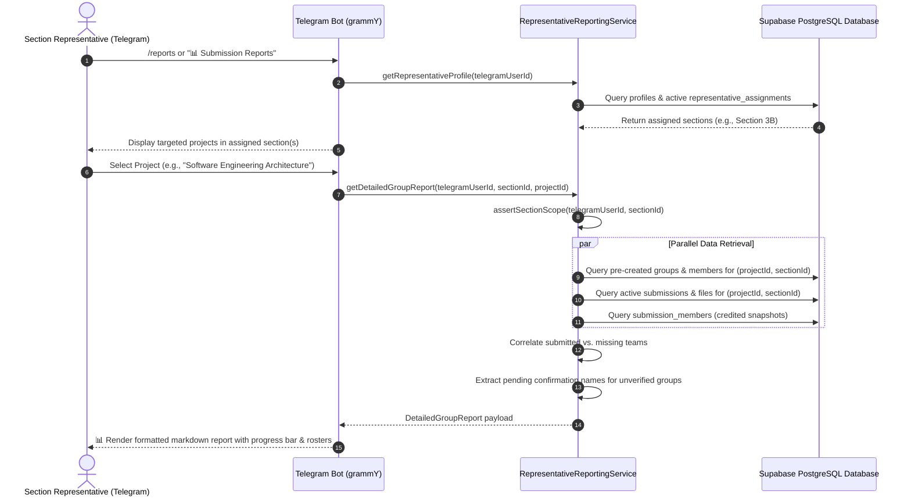

# HU-ASMS: Representative Reporting & Monitoring Architecture

## 1. Overview

The **Representative Reporting & Monitoring Suite** (Phase 10) provides academic section representatives with granular, real-time submission intelligence directly through the Telegram Bot (`apps/bot`) and backend APIs.

Representatives must monitor submission compliance for both individual and group projects. The reporting engine ensures:
1. **Strict Section Scope Isolation**: A representative can only inspect data for sections to which they are actively assigned. Attempting to query an outside section is denied at both the backend service and database RLS levels.
2. **Denominators Based on Verified Records**: All completion percentages and missing student rosters are computed dynamically from the official enrolled students and pre-created groups in the database, never assumed or hardcoded.
3. **Credited Member Attribution**: For group projects, the reporting engine queries `submission_members` to display the exact snapshot of confirmed students credited for the submission.
4. **Diagnostic Missing Rosters**: Identifies unsubmitted students (with HU Student IDs and Telegram link status) and unverified groups (with names of members whose confirmations are pending).
5. **Multi-Target Project Partitioning**: Projects targeted across multiple academic years or sections automatically scope reporting results to the representative's specific section.

---

## 2. Reporting Workflow Sequence Diagram

---

## 3. Reporting Types & Data Models

### 3.1 Individual Submission Report (`DetailedIndividualReport`)
- **Total Eligible**: Total enrolled students in the representative's section.
- **Submitted Students**:
  - Full Name & HU Student ID
  - Submission timestamp (UTC)
  - Submission version (`v1`, `v2`, etc.) and resubmission flag
  - Original file name, byte size, and MIME type
- **Missing Students**:
  - Full Name & HU Student ID
  - Registration status (`locked`, `pending`, `suspended`)
  - Telegram linkage flag (`isTelegramLinked`)

### 3.2 Group Submission Report (`DetailedGroupReport`)
- **Total Teams**: Total pre-created groups in the representative's section.
- **Submitted Teams**:
  - Group Code (e.g. `GRP-01`)
  - Submitting Leader Name & HU Student ID
  - Submission timestamp, version, file name, and byte size
  - **Credited Member Snapshot**: List of students immutably frozen in `submission_members` at upload time.
- **Missing Teams**:
  - Group Code & Designated Leader
  - Group Status (`verified`, `pending`, `declined`)
  - Member confirmation counts (`confirmed`, `pending`, `declined`)
  - Pending member names list (identifies who needs to confirm to unblock the group).

### 3.3 Section Summary Report (`SectionSummaryReport`)
- Overview of all open and past assignments targeted to the section.
- Progress bar and completion percentage per assignment.
- Past-deadline flag.

---

## 4. Multi-Section & Multi-Target Scope Rules

1. **Multi-Target Projects**:
   - If a project targets both `Section 3A` and `Section 3B`:
   - A representative assigned to `Section 3B` will only receive statistics, submitted records, and missing rosters for `Section 3B`.
   - Data for `Section 3A` is completely excluded from queries.
2. **Dual-Assigned Representatives**:
   - Representatives assigned to multiple sections (e.g., `Section 2A` and `Section 2B`) can toggle between their assigned scopes.
   - Each report query independently enforces the targeted section ID.
3. **Database RLS Policies**:
   - At the database level, `submissions`, `submission_files`, and `submission_members` use PostgreSQL Row Level Security restricting SELECT access to `auth_is_rep_for_section(section_id)`.
