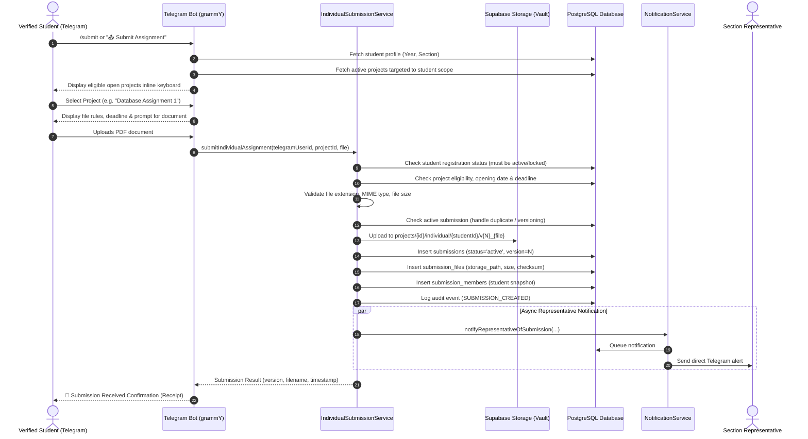
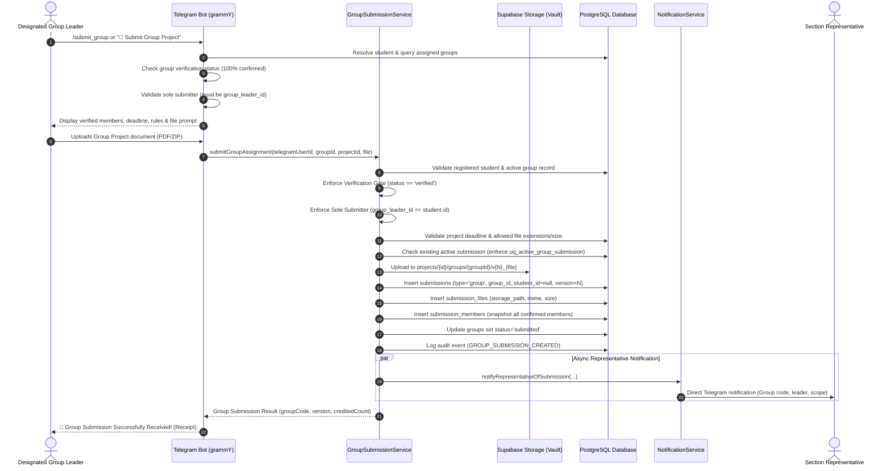

# HU-ASMS: Individual Submission Workflow Architecture

## 1. Overview

The Individual Submission engine allows registered and verified students to submit academic documents directly through the Telegram Bot (`apps/bot`).

Submissions are subject to strict security, scope-based eligibility, duplicate prevention, and automated routing rules:
1. **Automatic Scope Resolution**: The system retrieves the student's verified `academic_year_id` and `section_id`. Students cannot choose or alter their academic section or representative manually.
2. **Private Storage Vault**: Files are stored in private Supabase Storage (`submission-files-vault`). Only storage paths (not public URLs) and file metadata are saved in PostgreSQL.
3. **Duplicate Prevention & Versioning**:
   - Database constraint `uq_active_individual_submission` permits only **one active submission** per student per project.
   - If `resubmission_allowed` is true, submitting a new file increments `version` (e.g. `v1` -> `v2`), marks the previous record as `superseded`, and preserves complete historical records.
   - If `resubmission_allowed` is false, duplicate submissions are rejected immediately.
4. **Automatic Representative Routing**: Submissions resolve the section's active representatives from `representative_assignments` and dispatch real-time alerts. Notification failure is non-blocking to prevent corrupting or aborting successful submissions.
5. **Auditing**: Every submission and resubmission creates an immutable record in `audit_logs`.

---

## 2. End-to-End Submission Pipeline



---

## 3. Storage Hierarchy

Stored files follow an isolated relational folder hierarchy inside `submission-files-vault`:

```
submission-files-vault/
└── projects/
    └── {project_id}/
        ├── individual/
        │   └── {student_id}/
        │       ├── v1_assignment1.pdf        (status: 'superseded')
        │       └── v2_assignment1_rev.pdf    (status: 'active')
        └── groups/
            └── {group_id}/
                ├── v1_group_project.pdf      (status: 'superseded')
                └── v2_group_project_rev.pdf  (status: 'active')
```
- Short-lived signed download URLs (valid for 15–60 minutes) are generated on demand for authorized representatives.
- Files cannot be accessed publicly without Supabase authentication and matching representative section assignment.

---

## 4. Group Submission Architecture (Phase 09)

The Group Submission engine enforces strict multi-tenant teamwork verification and designated leader authorization before any group artifact can be ingested into the private vault.

### Core Security Invariants
1. **Verification Gate**:
   - Only groups with `status = 'verified'` can submit.
   - A group only becomes verified when **100% of assigned members independently confirm** via their Telegram accounts.
   - If any member is pending or declined, submissions are completely blocked, displaying the list of unconfirmed students.
2. **Sole Submitter Principle (Designated Leader)**:
   - Only the designated group leader (`groups.group_leader_id`) who has confirmed membership can upload the final project artifact.
   - Submissions from non-leader members or students outside the group are rejected immediately with descriptive guidance.
3. **Partitioned Scope & Foreign Keys**:
   - `submissions.submission_type` is `'group'`.
   - `submissions.student_id` is strictly `NULL`.
   - `submissions.group_id` references the verified group.
   - Submissions are restricted to the group's assigned project and section.
4. **Duplicate Prevention & Resubmissions**:
   - Database constraint `uq_active_group_submission` guarantees only **one active submission** per group per project.
   - If `resubmission_allowed = false`, subsequent submissions are blocked with an official duplicate warning notice.
   - If `resubmission_allowed = true`, submitting a new file increments `version` (e.g., `v1` $\rightarrow$ `v2`), supersedes the previous active record, and preserves the full audit trail.
5. **Team Snapshotting**:
   - At the exact moment of submission, all confirmed members of the group are snapshot into `submission_members` (recording `student_id`, `hu_student_id`, `student_name`, and `is_submitter: true` for the leader).
   - This ensures permanent academic attribution even if group configurations are later modified.
6. **Non-Blocking Representative Routing**:
   - Dispatches a real-time notification to the section representative. Any network or Telegram delivery failure is caught and logged, guaranteeing that student submissions are never aborted or corrupted.

### Group Submission Sequence Diagram


