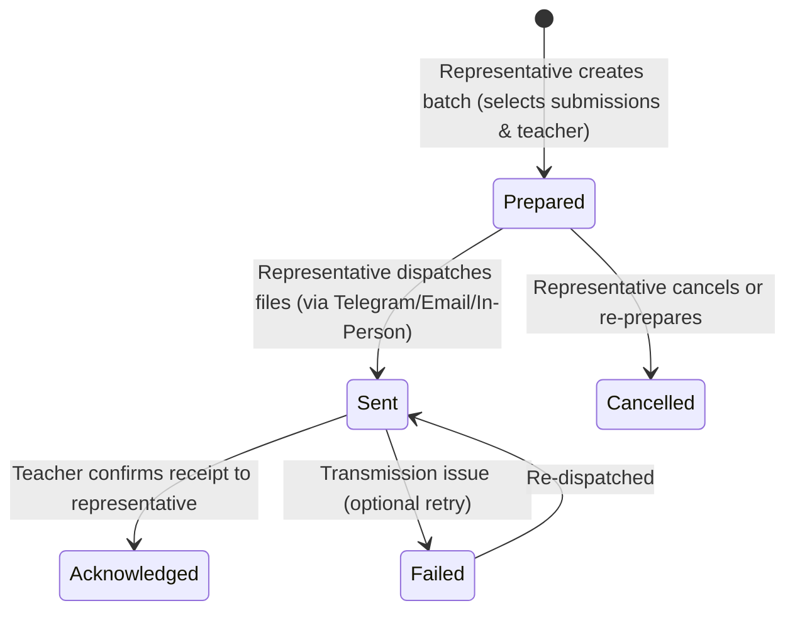

# Teacher Delivery Workflow & Representative Web Portal (Phase 12)

## 1. Overview & Architectural Principles

In the Haramaya University Academic Submission Management System (HU-ASMS), **Teacher Delivery** represents the final milestone of the submission collection cycle. 

Unlike conventional learning management systems that automatically dump student files to instructors, HU-ASMS enforces a **manual, representative-controlled batching and delivery process**:

1. **Representative Agency & Responsibility**: The section representative explicitly verifies student and group submissions, compiles them into curated batches, and controls when and how files are handed off to the course instructor.
2. **Strict Section Scope Isolation**: Representatives can only view, batch, and deliver submissions from students and groups enrolled in their specifically assigned sections. Cross-section bundling is strictly rejected at database, API, and UI levels.
3. **No Unrestricted Public File Links**: Submissions are stored in a private Supabase Storage vault (`submission-files-vault`). The delivery manifest generates temporary, short-lived (15-minute / 900-second) signed URLs that expire automatically after the teacher downloads them.
4. **End-to-End Delivery Tracking**: Every delivery batch tracks a rigorous lifecycle (`prepared` $\rightarrow$ `sent` $\rightarrow$ `acknowledged`), recording timestamps, delivery channels, dispatch notes, and representative identity in immutable audit logs.
5. **Multi-Channel Dispatch Support**: Deliveries can be dispatched via Telegram (with one-click formatted text copying), Institutional Email, or In-Person USB/hardcopy handoff.

---

## 2. Delivery Batch Lifecycle & State Machine



### State Definitions
- **`prepared`**: The delivery record is created in `deliveries` and submissions are linked via `delivery_items`. The batch count is locked, and temporary signed download links are ready for generation.
- **`sent`**: The representative has forwarded the package manifest and files to the instructor. The `sent_at` timestamp and dispatch notes are permanently recorded.
- **`acknowledged`**: The teacher has confirmed receipt of the assignments. The `acknowledged_at` timestamp is recorded, closing the delivery cycle.
- **`failed`**: Recorded if an email or message delivery fails or is rejected, requiring re-dispatch.

---

## 3. Database Schema & Row-Level Security

### 3.1 Tables

```sql
-- deliveries: Master delivery batch record
CREATE TABLE deliveries (
  id UUID PRIMARY KEY DEFAULT gen_random_uuid(),
  project_id UUID NOT NULL REFERENCES projects(id) ON DELETE RESTRICT,
  section_id UUID NOT NULL REFERENCES sections(id) ON DELETE RESTRICT,
  course_id UUID NOT NULL REFERENCES courses(id) ON DELETE RESTRICT,
  teacher_id UUID NOT NULL REFERENCES teachers(id) ON DELETE RESTRICT,
  representative_id UUID NOT NULL REFERENCES profiles(id) ON DELETE RESTRICT,
  batch_count INTEGER NOT NULL CHECK (batch_count > 0),
  status delivery_status NOT NULL DEFAULT 'prepared',
  channel VARCHAR(50) NOT NULL CHECK (channel IN ('telegram', 'email', 'in_person')),
  delivery_notes TEXT,
  prepared_at TIMESTAMPTZ NOT NULL DEFAULT NOW(),
  sent_at TIMESTAMPTZ,
  acknowledged_at TIMESTAMPTZ,
  created_at TIMESTAMPTZ NOT NULL DEFAULT NOW(),
  updated_at TIMESTAMPTZ NOT NULL DEFAULT NOW()
);

-- delivery_items: Maps submissions to batches
CREATE TABLE delivery_items (
  id UUID PRIMARY KEY DEFAULT gen_random_uuid(),
  delivery_id UUID NOT NULL REFERENCES deliveries(id) ON DELETE CASCADE,
  submission_id UUID NOT NULL REFERENCES submissions(id) ON DELETE RESTRICT,
  created_at TIMESTAMPTZ NOT NULL DEFAULT NOW(),
  CONSTRAINT uq_delivery_submission UNIQUE (delivery_id, submission_id)
);
```

### 3.2 Row-Level Security Policies (Migration `20261110000004`)
- **System Owner**: Full SELECT, INSERT, UPDATE, DELETE across all deliveries and delivery items.
- **Representatives**:
  - `deliveries`: SELECT and INSERT restricted to sections where `representative_assignments.profile_id = auth.uid() AND is_active = true`. UPDATE restricted to status, notes, `sent_at`, and `acknowledged_at` for batches in assigned sections.
  - `delivery_items`: SELECT and INSERT permitted only if the parent `delivery_id` belongs to an assigned active section of the authenticated representative.

---

## 4. Temporary 15-Minute Signed URL Delivery Manifest

Files are held in the private Supabase Storage bucket `submission-files-vault`. Unauthenticated or public access is strictly prohibited.

When the representative views the delivery package or copies the manifest:
1. Server verifies representative session and section scope.
2. For each submission in the batch, the server calls `supabase.storage.from('submission-files-vault').createSignedUrl(storage_path, 900)`.
3. Signed URLs have a strict 15-minute Time-To-Live (TTL).
4. The representative web UI generates a formatted Telegram text template:

```text
📋 HU-ASMS Official Submission Delivery
========================================
📚 Course: Operating Systems (COSC301)
📝 Project: OS Kernel Lab
🏢 Academic Section: 3rd Year - Section B
👨‍🏫 Recipient: Dr. Kebede (@dr_kebede)
📦 Batch Count: 2 submissions
📅 Dispatched: 11/10/2026, 7:15 PM

Submission Packages:
1. Abdi Mohammed (Individual)
   📄 Kernel_Lab_Abdi.pdf (2.05 MB)
   🔗 Download: https://.../submission-files-vault/projects/...?token=...

2. Group 04 (Team)
   📄 Group04_Final.zip (5.24 MB)
   🔗 Download: https://.../submission-files-vault/projects/...?token=...

⚠️ NOTE: Download links expire in 15 minutes for university data protection.
```

The representative can copy this formatted message with a single click and send it directly to the teacher via Telegram.

---

## 5. Representative Group Pre-Creation Invariants (Phase 08 Integration)

Representatives can pre-create project groups in the Representative Web Portal (`/rep/groups/new`) under strict compliance with Phase 08 rules:

1. **Submission Type Guard**: The target project must have `submission_type` set to `'group'` or `'both'`.
2. **Capacity Bounds**: Members count must strictly satisfy `min_group_size <= count <= max_group_size` defined in the project's file rules.
3. **Leader Inclusion**: The designated group leader must be a member of the selected students.
4. **Unique Group Code**: Group numbers/codes must be unique within the given `(project_id, section_id)` pair.
5. **Section Scope Boundary**: All assigned students must be actively enrolled in the representative's assigned section. Cross-section membership is blocked.
6. **Student Status Check**: Suspended students cannot be assigned to any group.
7. **Single Group Per Project**: A student cannot belong to more than one group for the same project.
8. **Confirmation Status Invariant**: Pre-created groups are stored in `status: 'pending'`, with the leader confirmed and all other members set to `confirmation_status: 'pending'`. The group only transitions to `verified` when 100% of members independently confirm via the Telegram bot (`/group`).
9. **Full Audit Logging**: Pre-creation generates an immutable `GROUP_PRECREATED` audit log.

---

## 6. Verification & Test Suite Summary

- **Teacher Delivery Unit Tests**: `apps/web/test/delivery.service.test.ts` (9 tests covering preparation, scope isolation, cross-section prevention, state transitions, manifest generation, signed URLs).
- **Group Pre-Creation Unit Tests**: `apps/web/test/group-precreation.service.test.ts` (9 tests covering invariants, capacity limits, single group per project, cross-section rejection, suspended student rejection).
- **Signed URL & Secret Hygiene Tests**: `apps/web/test/signed-url.test.ts`, `auth-roles.test.ts`, `secret-hygiene.test.ts` (15 tests).
- **Workspace Test Coverage**: 111 total tests across 39 suites with **87.94%** line coverage.
